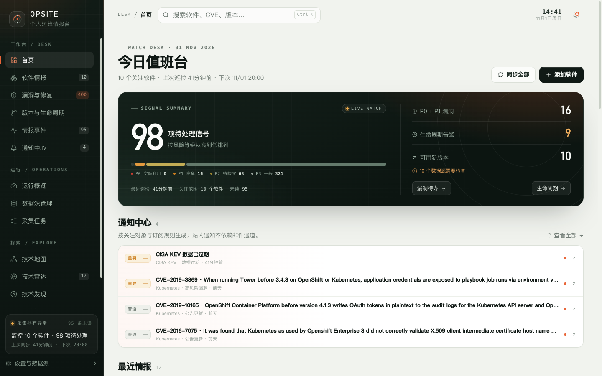
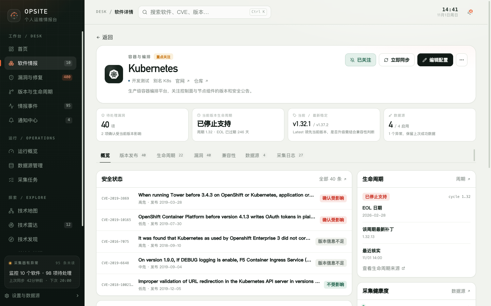
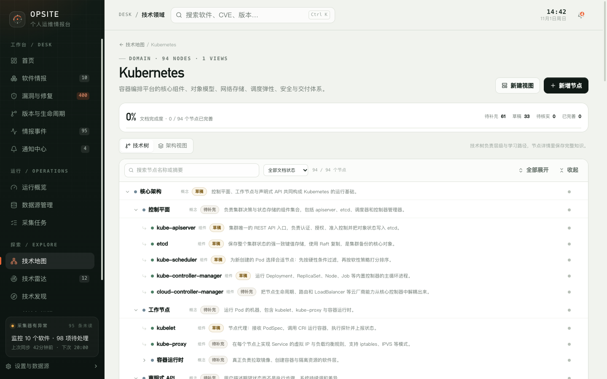
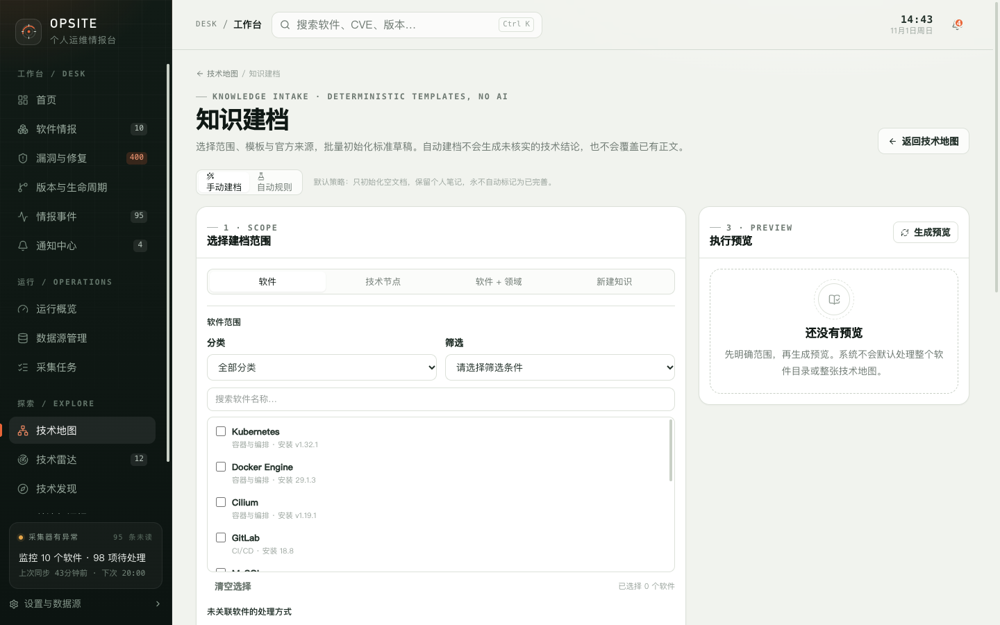

# Opsite · 个人运维情报与技术知识工作台

Opsite 是一个**单用户、本地优先、可自托管**的个人运维情报与技术知识工作台。

它把关注软件的版本发布、生命周期、安全漏洞和 CISA KEV 实际利用信息收敛到一份软件清单里；同时提供技术雷达、技术发现、技术地图、知识笔记和标准化知识建档，把“外部情报”和“自己的技术理解”放在同一个本地应用中。

- 数据默认保存在本机 SQLite，不依赖云端账号。
- 单用户、无登录，适合个人或受信任的本机环境。
- 外部数据通过后端固定适配器采集，API 凭据不会下发到浏览器。
- 支持 Docker Compose 自托管，也支持本地开发运行。

当前版本：`0.1.0`。项目仍在早期阶段，功能和接口可能变化。

## 界面预览

以下截图来自实际运行的 Opsite 实例，已去除浏览器地址栏和部署信息。

| 今日值班台 | 软件详情 |
| --- | --- |
|  |  |

| 技术地图 | 知识建档 |
| --- | --- |
|  |  |

更多界面截图见[用户手册](docs/user-guide/README.md)。

## 核心能力

| 能力 | 说明 |
| --- | --- |
| 软件情报 | 维护软件清单、当前版本和使用状态，汇总版本发布、生命周期、漏洞和 KEV 信息 |
| 漏洞与修复 | 合并 GitHub Advisory、NVD 和 CISA KEV，按严重程度、KEV 和本地版本影响判断优先级 |
| 情报事件 | 同一信号按去重键合并为主事件，区分首次发现时间与上游发布时间，支持筛选和处置状态 |
| 关注与通知 | 关注软件、雷达条目、发现候选或单条公告；站内通知先落库，邮件由独立队列发送 |
| 技术雷达 | 记录待评估、试用、采用、稍后关注和已忽略的技术，保留评估与决策过程 |
| 技术发现 | 从 GitHub 搜索和 CNCF Landscape 发现候选项目，由用户决定是否加入雷达 |
| 我的知识库 | 保存技术节点文档和个人技术笔记；个人笔记可关联软件和技术节点 |
| 技术地图 | 用技术领域、技术树和架构视图组织技术体系，维护掌握状态、关注级别、笔记和待研究问题 |
| 知识建档 | 用固定模板初始化技术文档；支持预览、自动规则、Linter、URL 检查和关联审查 |
| 运行中心 | 查看数据源、采集任务、真实执行记录、健康状态、配额和数据新鲜度 |
| 数据与备份 | 下载 SQLite 一致性快照；数据默认保存在本地 `data/` 目录 |

### 知识建档的边界

知识建档只做确定性工作：

- 使用固定模板和已知结构化信息初始化文档；
- 已有正文不覆盖，个人笔记不修改；
- 草稿状态不会自动改为已完善；
- 不生成 AI 技术结论；
- 不自动推断技术关系；
- 链接可达不代表内容已核实。

## 技术栈

- 前端：React 19、TypeScript、Vite、Tailwind CSS 4
- 后端：Express 5、better-sqlite3、Zod、node-cron、nodemailer
- 数据：SQLite，WAL 模式
- 测试：Vitest、Testing Library
- 部署：Docker / Docker Compose，Node.js 22 LTS

## 快速部署（Docker Compose）

前置条件：Docker 与 Docker Compose v2。

```bash
git clone https://github.com/zlcxk/opsite.git
cd opsite
cp .env.example .env
docker compose up -d --build
```

打开 <http://localhost:8787>。

默认行为：

- SQLite 数据保存在命名卷 `opsite-data`，容器内路径为 `/app/data`。
- 宿主机端口默认只绑定 `127.0.0.1`，不会直接暴露到局域网。
- 服务以非 root 用户运行，根文件系统只读，只有数据卷可写。
- `.env`、`data/`、`node_modules/` 不会进入镜像。

常用命令：

```bash
docker compose logs -f          # 查看日志
docker compose down             # 停止，保留数据卷
docker compose down -v          # 停止并删除数据卷（不可恢复）
docker compose ps               # 查看容器状态
```

如需改宿主机端口：

```bash
OPSITE_PORT=8788 docker compose up -d
```

升级时保留数据卷：

```bash
git pull
docker compose up -d --build
```

不要把宿主机端口直接映射到公网。应用没有登录和权限控制，公网部署需要额外的反向代理认证、TLS 和网络隔离，详见 [SECURITY.md](SECURITY.md)。

## 本地开发

要求：

- Node.js 22.12 LTS 或 24 LTS（测试工具 Vitest 当前不支持 Node 23）
- npm 10 或更高版本

```bash
git clone https://github.com/zlcxk/opsite.git
cd opsite
npm ci
cp .env.example .env
npm run dev
```

- 前端：<http://localhost:5173>
- API：<http://127.0.0.1:8787>

Vite 会把 `/api` 代理到本地 API 进程。`.env.example` 默认 `HOST=127.0.0.1`，只监听本机。

常用命令：

```bash
npm run dev            # 同时启动 API 和前端
npm test               # 运行测试
npm run test:watch     # 监听模式
npm run build          # TypeScript 检查 + 前端生产构建
npm run build:server   # 编译服务端
npm start              # 用 tsx 直接运行服务端（依赖开发依赖）
```

生产环境优先使用 Docker。如果不用 Docker，可以在完整安装依赖后执行：

```bash
npm run build
npm run build:server
DATA_DIR=data CLIENT_DIR=dist/client node dist-server/server/index.js
```

`npm start` 通过 `tsx` 运行 TypeScript 源码，需要开发依赖，并会读取项目根目录的 `.env`。`node dist-server/server/index.js` 运行编译后的 JavaScript，适合只安装生产依赖的环境；此时服务端目录是 `dist-server/server`，需要显式设置 `DATA_DIR` 和 `CLIENT_DIR`，否则默认会指向 `dist-server/data` 和 `dist-server/dist/client`。编译后运行也不会自动读取仓库根目录的 `.env`，请通过进程环境变量传入配置。

## 配置

API 启动时会读取项目根目录的 `.env`（文件不存在则跳过）。也可以直接通过进程环境变量传入，进程环境变量优先。

| 变量 | 默认值 | 说明 |
| --- | --- | --- |
| `PORT` | `8787` | API 和生产页面端口 |
| `HOST` | `127.0.0.1` | 监听地址；只有明确需要局域网访问时才改成 `0.0.0.0` |
| `DATA_DIR` | 项目内 `data/` | SQLite 与密钥的数据目录；Docker 中为 `/app/data` |
| `CLIENT_DIR` | 项目内 `dist/client` | 前端静态资源目录；Docker 中为 `/app/dist/client` |
| `GITHUB_TOKEN` | 空 | 提高 GitHub Releases、Advisory 和技术发现的速率上限 |
| `NVD_API_KEY` | 空 | 缩短 NVD 请求间隔 |
| `DISABLE_SCHEDULER` | `false` | `true` 时关闭软件同步与技术发现定时任务 |
| `SYNC_CRON` | `0 */6 * * *` | 初始软件同步周期；也可在设置页修改 |
| `DISCOVERY_ENABLED` | `true` | `false` 时只关闭技术发现自动采集 |
| `DISCOVERY_CRON` | `0 9 * * *` | 技术发现采集周期 |
| `DISCOVERY_TIMEZONE` | `Asia/Shanghai` | 技术发现时区 |
| `OPSITE_SECRET` | 空 | 加密 SMTP 密码的应用密钥；留空时自动生成 `data/.secret` |
| `PUBLIC_BASE_URL` | `http://127.0.0.1:<PORT>` | 邮件内站内链接前缀 |
| `NOTIFICATION_TIMEZONE` | `Asia/Shanghai` | 免打扰时段与每日摘要时区 |
| `DISABLE_EMAIL_QUEUE` | `false` | `true` 时停止后台邮件发送队列 |

说明：

- 表中的“项目内”路径以运行入口所在目录为基准：`npm run dev` 和 `npm start` 是仓库根目录；编译后运行是 `dist-server`。非默认目录布局请显式设置 `DATA_DIR` 和 `CLIENT_DIR`。
- `GITHUB_TOKEN`、`NVD_API_KEY` 只从服务端环境变量读取；设置页只显示“已配置 / 未配置”。
- SMTP 密码使用 AES-256-GCM 加密存储，接口只返回是否已配置。
- 修改进程环境变量后需要重启 API。
- Docker Compose 会从 `.env` 读取 `OPSITE_PORT`、`GITHUB_TOKEN`、`NVD_API_KEY` 等变量；容器内部仍使用固定路径和 `HOST=0.0.0.0`，宿主机端口默认只绑定 `127.0.0.1`。

## 数据与备份

默认数据目录为项目内的 `data/`：

```text
data/
├── opsite.db        # SQLite 主数据库
├── opsite.db-wal    # WAL
├── opsite.db-shm    # 共享内存
├── .secret          # 自动生成的 SMTP 加密密钥（可选）
└── backups/         # 服务端生成的备份副本
```

`data/` 已被 `.gitignore` 忽略，不要提交数据库或备份。

### 下载备份

设置页“数据与备份”可以下载 SQLite 快照。服务端通过 `VACUUM INTO` 生成一致性副本，并把副本写入服务启动目录下的 `data/backups/`；Docker 中对应 `/app/data/backups/`。下载后请自行保管。

### 手动备份

以下命令假设从仓库根目录启动，并使用默认 `DATA_DIR`。Docker 数据卷中的数据库请通过设置页下载备份，或使用 `docker cp` 从容器/卷中取出。

先停止服务，避免写入竞争。

macOS / Linux：

```bash
cp data/opsite.db "data/opsite.backup-$(date +%F-%H%M%S).db"
```

Windows：

```bat
copy data\opsite.db data\opsite.backup.db
```

### 恢复

先停止服务，再替换数据库，并删除旧的 WAL / SHM 文件：

macOS / Linux：

```bash
cp data/opsite.db data/opsite.before-restore.db
cp data/backups/opsite-YYYY-MM-DD....db data/opsite.db
rm -f data/opsite.db-wal data/opsite.db-shm
```

Windows：

```bat
copy data\opsite.db data\opsite.before-restore.db
copy data\backups\opsite-YYYY-MM-DD....db data\opsite.db
del data\opsite.db-wal data\opsite.db-shm
```

然后重启服务。

备份数据库**不包含** `data/.secret`。恢复后如果要继续解密已保存的 SMTP 密码，请保留原来的 `OPSITE_SECRET` 或同时恢复 `data/.secret`；否则在设置页重新填写 SMTP 密码。

## 安全边界

Opsite 是**单用户、无登录**的本地应用，不是面向公网的多用户系统。

- 默认监听 `127.0.0.1`，Docker 宿主机端口默认也只绑定 `127.0.0.1`。
- 没有账号、角色、权限、会话或审计日志；能访问 API 的客户端被视为可信用户。
- `/api/backup` 会导出完整数据库，不应暴露给不受信任的网络。
- 不要把 Opsite 直接部署到公网。
- 如需局域网访问，至少使用防火墙限制来源，并在反向代理层增加认证和 TLS。
- SMTP 密码、GitHub Token、NVD API Key 和数据库都属于敏感信息，不要提交或截图外传。
- 外部 URL 检查包含 SSRF 防护，但链接可达不等于技术结论正确。
- 邮件正文会对外部标题、摘要和来源名称做 HTML 转义，外部链接只允许 HTTP/HTTPS。

完整说明见 [SECURITY.md](SECURITY.md)。

## 当前限制

- 没有多用户、RBAC、登录、同步冲突合并等企业能力。
- 没有内置的 TLS、反向代理、公网认证或 WAF。
- 邮件依赖用户自己的 SMTP 服务；后台队列要求 API 进程常驻。
- 没有浏览器 Web Push、桌面通知或移动端推送。
- `upstream_advisory` 适配器尚未接入具体厂商 API，在运行中心保持停用。
- 采集失败时保留上一次成功数据，并把数据源标记为异常或过期。
- 技术地图提供树和架构视图，但没有多人实时协同编辑。
- 架构视图保存采用整张图覆盖，同一时间建议只在一个标签页编辑同一张视图。
- 知识建档不提供 AI 生成、自动关系推断或自动状态变更。
- 内置 Kubernetes、Prometheus 知识内容不会根据采集结果自动修改。

## 文档

- [文档索引](docs/README.md)
- [用户手册](docs/user-guide/README.md)
- [开发文档](docs/development/README.md)
- 历史阶段验收记录：`docs/p5.4/`、`docs/p5.4.1/`、`docs/p5.4.2/`、`docs/p5.4.3/`、`docs/p5.5.1/`、`docs/p5.5.1.1/`

## 许可证与贡献

- 许可证：[Apache License 2.0](LICENSE)
- 版权与第三方说明：[NOTICE](NOTICE)、[THIRD_PARTY_NOTICES.md](THIRD_PARTY_NOTICES.md)
- 贡献指南：[CONTRIBUTING.md](CONTRIBUTING.md)
- 安全策略：[SECURITY.md](SECURITY.md)

除非明确声明，提交到本仓库的贡献按 Apache-2.0 授权。
