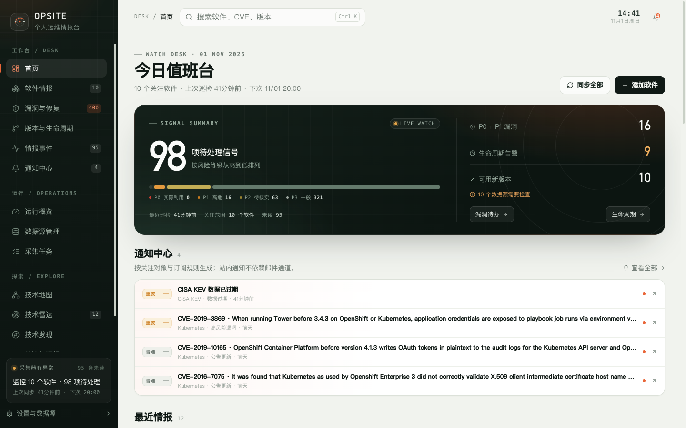

# 3. 首页与今日值班台

首页是每天打开 Opsite 的起点。它不展示所有数据，而是把需要你处理的信号、最近通知和相关软件压缩到一屏。



## 3.1 页面组成

从上到下依次是：

1. 页头和操作按钮；
2. 待处理信号摘要；
3. 风险指标和快捷入口；
4. 通知中心摘要；
5. 最近情报；
6. 我的软件；
7. 技术雷达摘要。

页面每 30 秒自动刷新一次。刷新失败时会保留上一次成功加载的数据，并在页面顶部提示错误。

## 3.2 页头

标题下方显示：

- 关注软件数量；
- 上次巡检时间；
- 下一次计划同步时间（如果调度器开启）。

右上角有两个按钮：

| 按钮 | 行为 |
| --- | --- |
| 同步全部 | 触发全部关注软件的同步；可能需要几分钟，完成后提示成功和失败数量 |
| 添加软件 | 打开“添加软件”弹窗，与软件清单页的入口相同 |

首次使用时清单为空，页面会显示“从关注第一个软件开始”，并提供“添加第一个软件”“先配置数据源”两个入口，以及 Kubernetes、PostgreSQL、NGINX、Redis 等常用起点。

## 3.3 待处理信号

大数字“N 项待处理信号”的计算口径是：

```text
P0 + P1 + P2 的未处置公告
+ 生命周期告警软件数
+ 数据源异常数
```

它**不包含** P3 公告，也不把“可用新版本”算作待办。新版本是信息，不是必须处理的事项。

频谱条显示当前未处置公告的优先级分布：

| 标签 | 含义 |
| --- | --- |
| P0 实际利用 | 优先级 P0 的未处置公告 |
| P1 高危 | 优先级 P1 的未处置公告 |
| P2 待核实 | 优先级 P2 的未处置公告 |
| P3 一般 | 优先级 P3 的未处置公告 |

> “P0 实际利用”是界面文案，统计的是 P0 公告。P0 的典型条件是命中 KEV 且本地版本确认受影响，但请以漏洞详情中的标签为准。

## 3.4 风险指标

右侧显示：

- **P0 + P1 漏洞**：需要优先查看的公告数量；
- **生命周期告警**：当前处于“即将停止支持”或“已停止支持”的软件数量；
- **可用新版本**：最新稳定版高于当前版本的软件数量；
- **N 个数据源需要检查**：存在采集失败或数据过期的数据源时出现。

“漏洞待办”跳到漏洞与修复页面，“生命周期”跳到版本与生命周期页面。

## 3.5 通知中心摘要

只有存在未读通知或最近通知时才显示这个区块。最多展示 4 条，包含：

- 通知级别；
- 标题；
- 关注对象、规则名称和相对时间。

“查看全部”进入通知中心。站内通知不依赖邮件通道；没有配置 SMTP 也能收到。

## 3.6 最近情报

展示最近的情报事件，按风险等级和首次发现时间排序，最多 6 条。点击进入对应软件的漏洞、版本或生命周期标签。

首次采集完成前，这里会显示“还没有情报事件”。

## 3.7 我的软件

软件区块支持：

- **筛选**：全部、安全风险、有新版本、生命周期异常、数据源异常；
- **搜索**：按软件名称筛选；
- **排序**：风险优先、最近更新、名称排序。

“最近更新”按最近同步时间排序，不是按上游发布时间。置顶软件始终排在最前面。

卡片上可以直接查看当前版本、最新稳定版、安全状态和生命周期。卡片菜单提供：

- 编辑配置；
- 立即同步；
- 暂停 / 恢复关注；
- 置顶到首页 / 取消置顶；
- 归档软件。

> 归档不会删除历史数据，但当前界面没有恢复已归档软件的入口。归档前请确认不再需要持续关注。

## 3.8 技术雷达摘要

首页展示部分雷达条目。没有条目时显示“雷达还没有条目”，可以通过侧边栏进入技术雷达添加。

## 3.9 推荐的值班习惯

每天：

1. 看“待处理信号”是否上升；
2. 打开“漏洞与修复”，先处理 P0 / P1 和命中 KEV 的公告；
3. 在“情报事件”中确认新信号，把已完成的标记为已解决；
4. 检查首页是否提示数据源异常。

每周：

1. 查看“版本与生命周期”，确认是否有即将 EOL 的软件；
2. 检查“运行中心”的采集成功率和数据新鲜度；
3. 清理已经不再关注的软件或公告。

## 3.10 限制

- 首页是摘要，不是完整列表；更多记录要到对应页面查看。
- 新版本数量不代表建议升级，兼容性和升级路径需要自行判断。
- 自动刷新只更新展示数据，不会自动改变你的处置状态。
- 同步全部可能触发较多外部请求，受 GitHub、NVD 等上游速率限制影响。

下一步：[软件情报](04-software.md)。
