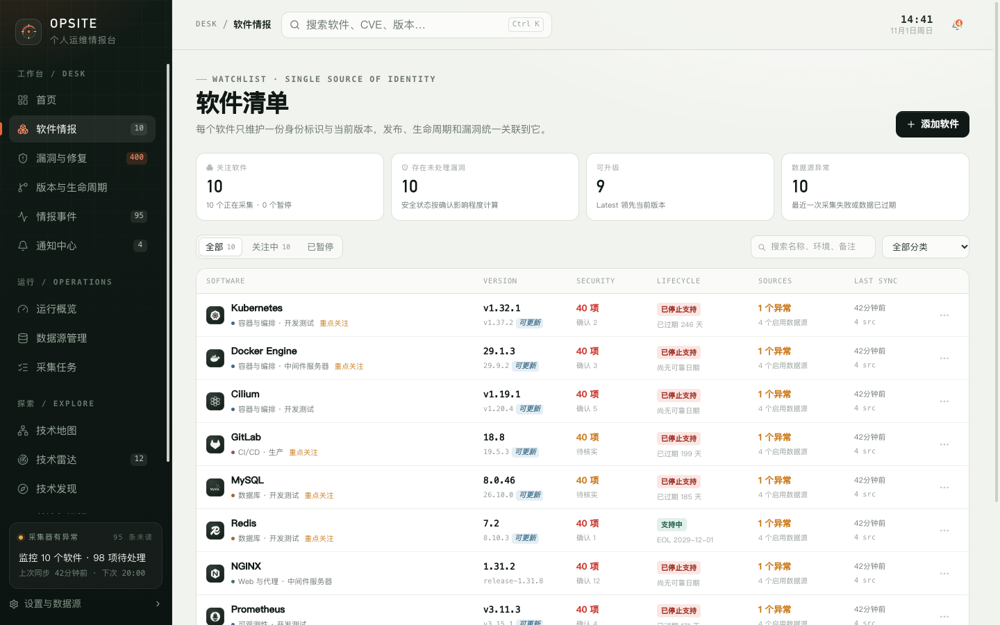
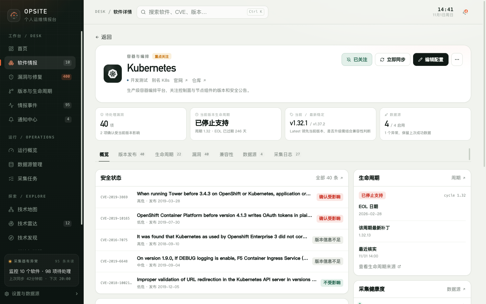

# 4. 软件情报

软件清单是 Opsite 的数据锚点。版本发布、生命周期、安全公告和情报事件都关联到软件条目，因此先把软件身份和当前版本维护准确，后续判断才有意义。

## 4.1 软件清单

页面标题为“软件清单”，每行代表一个被关注的软件。

### 顶部指标

| 指标 | 含义 |
| --- | --- |
| 关注软件 | 未归档软件总数；脚注显示正在采集和已暂停的数量 |
| 存在未处理漏洞 | 至少有一条未处置公告的软件数量 |
| 可升级 | 最新稳定版高于当前版本的软件数量 |
| 数据源异常 | 最近一次采集失败或数据已过期的软件数量 |

> “存在未处理漏洞”按“有未处置公告”计数，不等同于“确认受当前版本影响”。后者要到软件详情查看。

### 筛选

- **状态**：全部、关注中、已暂停；
- **搜索**：按名称、环境、备注匹配；
- **分类**：全部或已有分类。

### 表格列

| 列 | 内容 |
| --- | --- |
| Software | 软件名、分类、环境、关注级别和加载状态 |
| Version | 当前版本和最新稳定版；有更新时显示“可更新” |
| Security | “无待处理”或公告数量，以及确认受影响、待核实数量 |
| Lifecycle | 支持状态和 EOL 文案 |
| Sources | 启用数据源数量，以及异常数据源数量 |
| Last sync | 最近同步时间和数据源数 |

点击整行进入软件详情。点击 Security、Lifecycle、Sources 单元格会直接打开对应标签。

每行的操作菜单提供：

- 编辑配置；
- 立即同步；
- 暂停关注 / 恢复关注；
- 置顶到首页 / 取消置顶；
- 归档软件。

## 4.2 添加软件

点击“添加软件”后，可以选择两种方式：

| 方式 | 适用场景 |
| --- | --- |
| 从目录选择 | Kubernetes、PostgreSQL、NGINX、Redis 等已内置目录项的常用软件 |
| 自定义软件 | 内部工具或目录中没有的软件 |

### 从目录选择

目录会显示搜索框、分类和覆盖等级：

- **覆盖完整**：生命周期、版本发布、漏洞公告和 KEV 都有较完整的数据源配置；
- **覆盖部分**：部分情报类型可用；
- **覆盖有限**：可用情报较少，仍可手动补充数据源配置。

选中目录项后会显示该软件可用的情报类型。目录模式不会展开每个数据源的详细配置，只能勾选启停。

### 通用字段

| 字段 | 必填 | 说明 |
| --- | --- | --- |
| 当前使用版本 | 否 | 例如 `v1.32.4`；不填会影响版本影响和生命周期判断 |
| 使用环境 / 备注 | 否 | 例如“生产集群 · 华东” |
| 关注级别 | 是 | 重点盯防、重点关注、常规关注；影响首页排序和通知策略 |
| 启用的情报类型 | 是 | 至少启用一个数据源 |
| 关注备注 | 否 | 记录关注原因或升级约束 |

### 自定义软件字段

除通用字段外，还包括：

- 软件名称（必填）；
- 分类（默认“其他”）；
- 官方网站；
- 上游仓库；
- Logo 地址；
- 简介。

自定义软件不会自动获得生命周期或漏洞匹配能力，需要你提供可靠的数据源标识。

### 软件级数据源配置

| 数据源 | 配置项 |
| --- | --- |
| endoflife.date | 产品标识，例如 `kubernetes` |
| GitHub Releases | 仓库，格式 `owner/repo` |
| GitHub Advisory | 软件包名称；生态可选 |
| NVD CVE | 关键词；CPE Name 可选且优先；匹配说明可选 |
| CISA KEV | 无需配置，仅对本地已采集 CVE 做交叉标记 |

至少需要启用一个数据源。保存后软件立即加入清单，并在后台触发首次采集。

> 目录项如果没有可用数据源，界面提示“添加后可在软件设置中补充数据源”，但当前表单仍要求至少启用一个源，可能阻止提交。遇到这种情况可以先用自定义条目，或等目录数据源可用后再添加。

## 4.3 编辑软件

编辑弹窗可以修改：

- 关注状态（关注中 / 暂停）；
- 软件名称；
- 分类；
- 当前使用版本；
- 使用环境 / 备注；
- 别名（逗号分隔）；
- 关注级别；
- 官方网站、上游仓库、Logo 地址；
- 简介 / 关注备注；
- 个人备注；
- 已存在数据源的启停和配置。

数据源不能在编辑弹窗中新增或删除，只能启停和修改配置。关闭数据源会保留历史数据，但不再参与常规采集。

修改当前版本时会出现警告：保存后会重新计算漏洞影响。数据源配置或启停变化会触发对应源的后台重采集。

暂停关注会停止定时采集和通知，但保留历史数据；你仍可在详情页手动同步。

## 4.4 软件详情

页头显示软件名、分类、别名、环境、官网、仓库、简介和关注状态。操作包括：

- 关注 / 已关注；
- 立即同步；
- 编辑配置；
- 暂停 / 恢复；
- 置顶 / 取消置顶；
- 归档。

四张摘要卡：

| 卡片 | 内容 |
| --- | --- |
| 待处理漏洞 | 数量，以及确认受当前版本影响的数量 |
| 当前版本生命周期 | 支持状态、当前周期和 EOL 提示 |
| 当前 / 最新稳定 | 当前版本、最新稳定版；提示“有新版本不等于建议升级” |
| 数据源 | 启用数量、异常数量和最近同步状态 |

### 标签页

| 标签 | 内容 |
| --- | --- |
| 概览 | 安全状态、最近版本、生命周期、采集健康度、个人备注、关联技术知识 |
| 版本发布 | 该软件的版本记录，最多 150 条，默认显示 40 条 |
| 生命周期 | 各周期、EOL 日期、支持状态和最新补丁 |
| 漏洞 | 该软件的公告，可按待处理 / 全部筛选 |
| 兼容性 | 关联的知识库记录和固定升级判断，不自动推断兼容性 |
| 数据源 | 每个源的配置、状态、最近同步和手动同步 |
| 采集日志 | 最近 60 条采集记录 |

### 生命周期提示

软件详情可能显示以下提示：

- 尚未配置当前使用版本，无法判断生命周期；
- 当前版本未匹配到生命周期记录；
- 不同来源对当前版本的生命周期判断不一致，待核实；
- 来源未提供明确的支持截止日期。

生命周期状态是实时推导的，不单独存储。修改当前版本或采集到新记录后会自动变化。

### 漏洞标签

漏洞标签只显示该软件的公告，可以切换“待处理 / 全部”。影响判断基于当前版本：

- 待处理只按处置状态判断，不会因为“不受影响”自动关闭；
- 公告按“确认受影响 → 可能受影响 → 版本信息不足 → 不受影响”排序；
- 点击公告打开详情抽屉，可修改处置状态或单独关注。

### 兼容性标签

Opsite 不会自动推断版本兼容性。该页展示知识库中关联到该软件的记录，并给出固定的升级判断信息：

- 当前版本；
- 最新稳定版；
- 版本差距；
- 生命周期建议。

这些信息用于辅助判断，不构成升级结论。

### 数据源标签

每个数据源显示配置摘要、状态、最近同步和条目数。状态包括：

- 正常；
- 异常；
- 未同步；
- 已停用。

可以“同步此源”或“修改配置”。启用状态下采集失败时，Opsite 保留上一次成功数据，并把数据源标记为异常或过期。

### 采集日志

显示时间、数据源、触发方式、状态、条目数、耗时和错误。触发方式包括手动、首次、定时；最多保留最近 60 条展示。

## 4.5 归档与恢复

归档后软件不再出现在首页和软件清单，但版本、生命周期、漏洞、事件和采集日志都会保留。

> 当前界面没有恢复已归档软件的入口。归档前请确认不再需要持续关注。

## 4.6 限制

- 当前版本需要手动维护，Opsite 不探测你实际运行的版本。
- 自定义软件需要自行提供数据源标识，否则无法获得自动情报。
- 数据源配置不在运行中心统一编辑；运行中心的数据源是全局适配器，软件级配置在软件弹窗中。
- 目录项的数据源覆盖程度由上游目录决定，可能需要手动补充。
- “有新版本”只是版本号比较，不代表兼容性或升级建议。

下一步：[漏洞与修复](05-vulnerabilities.md)。
