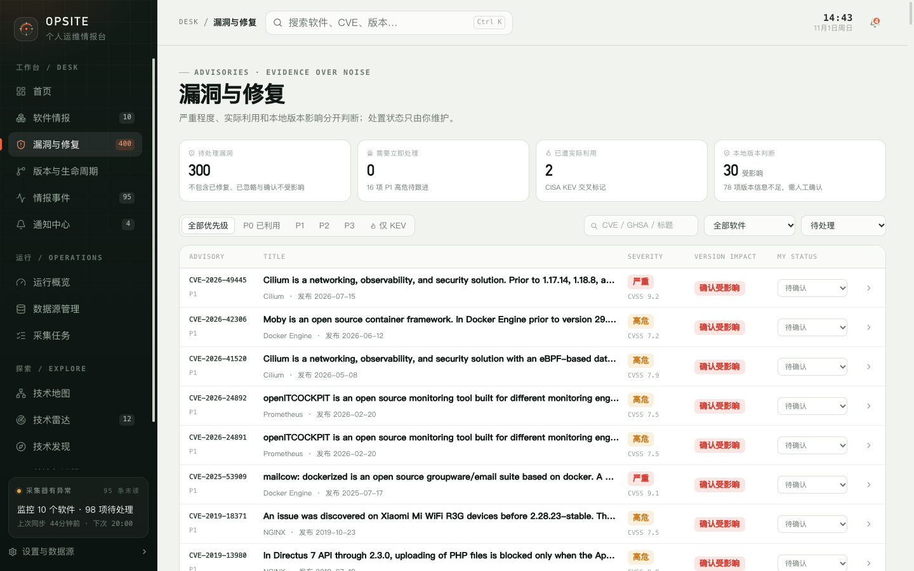

# 5. 漏洞与修复

“漏洞与修复”把多个来源的安全公告合并到软件清单上，并结合你填写的当前版本计算本地影响和优先级。

## 5.1 页面回答什么问题

- 当前有哪些**尚未处理**的漏洞？
- 哪些漏洞已经被 CISA KEV 确认在实际利用？
- 哪些公告影响我填写的当前版本？
- 每条公告我处理到哪一步了？

页面不会扫描你的主机或镜像，也不会替你判断业务影响。它只基于公开公告、你填写的版本和你的处置状态做整理。

## 5.2 顶部指标

| 指标 | 统计口径 |
| --- | --- |
| 待处理漏洞 | 处置状态不是“已修复”“确认不受影响”“已忽略”的公告总数 |
| 需要立即处理 | 待处理公告中优先级为 P0 的数量；脚注同时显示 P1 数量 |
| 已遭实际利用 | 待处理公告中命中 CISA KEV 的数量 |
| 本地版本判断 | 版本影响为“确认受影响”的数量；脚注显示“版本信息不足”的数量 |

“待处理”只看你的处置状态，不看优先级。把公告标为“已修复”后，它会从待处理统计中移除，但优先级本身不会改变。

## 5.3 优先级如何计算

优先级由三个因素共同决定：严重程度、CISA KEV 状态、本地版本影响。

| 优先级 | 典型条件 |
| --- | --- |
| P0 · 立即处理 | 命中 KEV，且本地版本确认受影响 |
| P1 · 高优先级 | 本地版本确认受影响，且严重程度为“严重”或“高危”；或可能受影响且命中 KEV |
| P2 · 需要核实 | 确认受影响但严重程度较低；可能受影响；版本信息不足且属于严重/高危或命中 KEV |
| P3 · 一般公告 | 其余情况 |

严重程度按 CVSS 分数划分：严重（≥ 9.0）、高危（≥ 7.0）、中危（≥ 4.0）、低危（> 0）、未知。

> 优先级不是“处理状态”。把公告标记为已修复不会把 P0 改成 P3；P 级只反映风险判断。

## 5.4 版本影响如何判断

版本影响由服务端自动计算，页面不提供手动修改入口：

| 标签 | 含义 |
| --- | --- |
| 确认受影响 | 当前版本能匹配上游提供的受影响范围 |
| 可能受影响 | 上游范围或版本关系只能部分判断 |
| 不受影响 | 所有可解析的受影响范围都不匹配当前版本 |
| 版本信息不足 | 没有当前版本、上游没有可解析范围，或范围无法解析 |

关键规则：

- 没有填写软件当前版本时，公告通常只能得到“版本信息不足”。
- 只要存在无法解析的范围，系统不会猜测为“不受影响”。
- “需人工确认”指的是“版本信息不足”的记录，需要你结合上游公告自行判断。
- 修改软件的当前版本后，相关公告的版本影响和优先级会在同步或重新计算时变化。

## 5.5 筛选与搜索

- **优先级**：全部优先级、P0 已利用、P1、P2、P3。
- **仅 KEV**：只显示命中 CISA KEV 的公告。
- **搜索**：按 CVE / GHSA / 标题、软件名匹配，输入即筛选。
- **软件**：全部软件或指定软件。
- **状态**：待处理（默认）、全部状态、待确认、待修复、已计划、已修复、确认不受影响、已忽略。

列表固定按优先级从高到低排列，同优先级内按发布时间倒序，没有表头排序。

## 5.6 表格字段

| 列 | 内容 |
| --- | --- |
| Advisory | 公告编号和优先级短标 |
| Title | 标题、软件名、发布日期；命中 KEV 时显示“KEV 已利用” |
| Severity | 严重程度和 CVSS 分数 |
| Version impact | 版本影响，以及上游给出的首个修复版本 |
| My status | 可直接修改的处置状态 |
| 箭头 | 打开公告详情抽屉 |

点击行或按 Enter 打开详情抽屉。

## 5.7 公告详情抽屉

抽屉展示：

- 公告编号、软件名、标题和描述；
- 严重程度、优先级、版本影响、KEV 状态；
- CVSS 分数及来源；
- 受影响范围和修复版本；
- 判定依据（为什么得到这个优先级）；
- 数据来源、外部编号、采集时间和外链；
- “我的处置状态”；
- 关注按钮。

除“处置状态”和“关注”外，其余字段均为只读，来自上游或自动计算。

## 5.8 处置状态

| 状态 | 用途 |
| --- | --- |
| 待确认 | 默认状态，尚未判断 |
| 待修复 | 已确认需要处理，尚未安排 |
| 已计划 | 已纳入升级或修复计划 |
| 已修复 | 本地已完成修复 |
| 确认不受影响 | 结合版本或配置判断不受影响 |
| 已忽略 | 明确不处理，例如环境不适用 |

处置状态由你维护，上游公告更新不会覆盖。把公告改为“已修复”“确认不受影响”或“已忽略”时，关联的漏洞事件会自动变为“已解决”。

## 5.9 关注单条公告

在抽屉右上角点击“关注”后，该公告会按订阅规则发送站内通知和邮件。取消关注不会删除已有通知和历史记录。

关注单条公告适合跟踪某个暂时无法升级、但需要持续观察的漏洞。

## 5.10 数据来源与刷新

公告来自 GitHub Advisory、NVD 和 CISA KEV：

- GitHub Advisory 和 NVD 提供公告、CVSS、受影响范围。
- CISA KEV 用于标记“已遭实际利用”，按 CVE 编号与本地公告匹配。
- KEV 命中后会保留历史标记，即使上游后来把该条目移出目录。

KEV 数据需要在运行中心启用 `cisa_kev` 数据源并成功采集。采集失败时，页面保留上一次成功数据。

## 5.11 限制

- 页面一次加载最多 300 条公告，没有分页；更早的记录不会显示，顶部指标也基于这批数据。
- 没有手动修改“版本影响”的入口，自动判断不适用时只能通过处置状态记录你的结论。
- 严重程度、CVSS、KEV 和受影响范围均以上游为准，Opsite 不做二次研判。
- 公告数量多时，建议用软件、优先级和状态组合筛选，而不是只依赖滚动。

下一步：[版本与生命周期](06-versions.md)。
