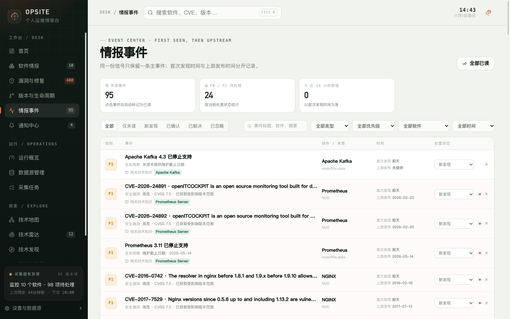

# 7. 情报事件

“情报事件”是 Opsite 的信号中心。它把同一份上游信号合并成一条主事件，并分别记录“本地首次发现时间”和“上游发布时间”。

## 7.1 为什么需要事件

同一个漏洞可能同时来自 GitHub Advisory、NVD 和 CISA KEV；同一个版本也可能被多个来源重复采集。如果每条来源记录都推送一次，你会收到大量重复提醒。

Opsite 的处理方式：

- 按去重键把同一信号合并为一个事件；
- 事件只保留一条主记录；
- 通知按事件派发，重复采集不会产生重复提醒；
- 来源细节仍保留在漏洞抽屉和软件详情中。

## 7.2 顶部指标

| 指标 | 含义 |
| --- | --- |
| 未读事件 | 尚未标记为已读的事件数量；点击事件后自动标记已读 |
| P0 / P1 待处理 | 优先级为 P0 或 P1，且处置状态不是“已解决”的事件 |
| 近 24 小时新增 | 首次发现时间在最近 24 小时内的事件 |

注意：“近 24 小时新增”按本地首次发现时间统计，不是上游发布时间。首次同步大量历史数据时，这个数字可能很高。

## 7.3 事件类型

| 类型 | 说明 |
| --- | --- |
| 安全漏洞 | 新公告、公告更新或 KEV 状态变化 |
| 版本发布 | 稳定版新版本；预发布不会生成发布事件 |
| 生命周期 | 软件进入即将 EOL、已 EOL，或 EOL 日期变化 |
| 采集异常 | 数据源级别的异常事件类型 |

## 7.4 去重规则

| 事件类型 | 去重键 | 结果 |
| --- | --- | --- |
| 漏洞 | 软件 + 公告 ID | 同一公告的多个来源合并为一条；KEV 更新复用原事件 |
| 版本发布 | 软件 + 版本号 | 同一稳定版只产生一条事件 |
| 生命周期 | 软件 + 周期 + 状态 + EOL 日期 | 状态或日期变化会产生新事件 |

因此：

- 一个漏洞事件可能对应多条上游来源，详见“漏洞与修复”的公告抽屉。
- 版本事件只在版本号首次出现时产生，不会因为再次采集而重复。
- 生命周期从“即将到期”变成“已停止支持”时，是新事件，不是旧事件被改写。

## 7.5 首次发现时间与上游发布时间的区别

| 字段 | 含义 |
| --- | --- |
| 首次发现 | 这条信号第一次写入本地数据库的时间；后续更新不会改变 |
| 上游发布 | 上游公告的发布时间，或生命周期的 EOL 日期；上游没有提供时显示“未提供” |

首次同步会把历史数据一次性写入，所以“首次发现=前天”不代表上游也是前天发布。

## 7.6 筛选与搜索

- **状态**：全部、仅未读、新发现、已确认、已解决、已忽略。
- **搜索**：事件标题、软件名、摘要。
- **类型**：全部类型、安全漏洞、版本发布、生命周期、采集异常。
- **优先级**：全部优先级、P0、P1、P2、P3。
- **软件**：全部软件或指定软件。
- **时间**：全部时间、近 24 小时、近 7 天、近 30 天，按首次发现时间计算。

列表按优先级和首次发现时间倒序排列，没有手动排序。

## 7.7 事件行内容

每条事件显示：

- 优先级色标；
- 标题、类型标签和摘要；
- 关联的技术知识节点（最多显示 4 个，更多显示 +N）；
- 软件名和来源名；
- 首次发现时间和上游发布时间；
- 处置状态下拉；
- 未读圆点；
- 上游外链。

点击事件行会：

1. 把未读事件标记为已读；
2. 同时把状态从“新发现”改为“已确认”；
3. 跳转到对应软件的漏洞、版本或生命周期标签。

如果你只想阅读、不想改变状态，可以先使用右上角“全部已读”，或在跳转后手动改回状态。

## 7.8 处置状态

| 状态 | 含义 |
| --- | --- |
| 新发现 | 默认状态，尚未查看或确认 |
| 已确认 | 已阅读并确认存在这条信号 |
| 已解决 | 已处理完成，或关联公告已修复/确认不受影响/忽略 |
| 已忽略 | 明确不处理 |

处置状态由你维护。上游更新不会覆盖它，但以下联动会发生：

- 把关联公告改为“已修复”“确认不受影响”或“已忽略”时，漏洞事件自动变为“已解决”。
- 在事件列表手动改回“新发现”时，会清除已读时间。
- “全部已读”只影响已读状态和“新发现→已确认”，不会把“已解决”或“已忽略”改回去。

## 7.9 通知关系

事件是通知的来源之一。事件创建时，系统会按关注对象和订阅规则决定是否生成站内通知或邮件：

- 首次全量采集只建事件，不发送通知，避免历史数据轰炸。
- 只有漏洞事件的标题、优先级或上游发布时间发生变化时，才会二次派发。
- 事件的未读数与“通知中心”的未读数是两套独立计数。

详见[关注、订阅与通知](08-follows-notifications.md)。

## 7.10 限制

- 页面一次加载最多 200 条事件，没有分页；顶部指标也基于这批加载结果。
- 一个事件合并了多来源信息，来源差异要到漏洞抽屉查看。
- 事件状态与公告处置状态名义独立，但公告进入终态会反向解决关联事件；事件侧改状态不会回写公告。
- “采集异常”类型在界面中保留，数据源异常更多体现在运行中心和通知中心。

下一步：[关注、订阅与通知](08-follows-notifications.md)。
