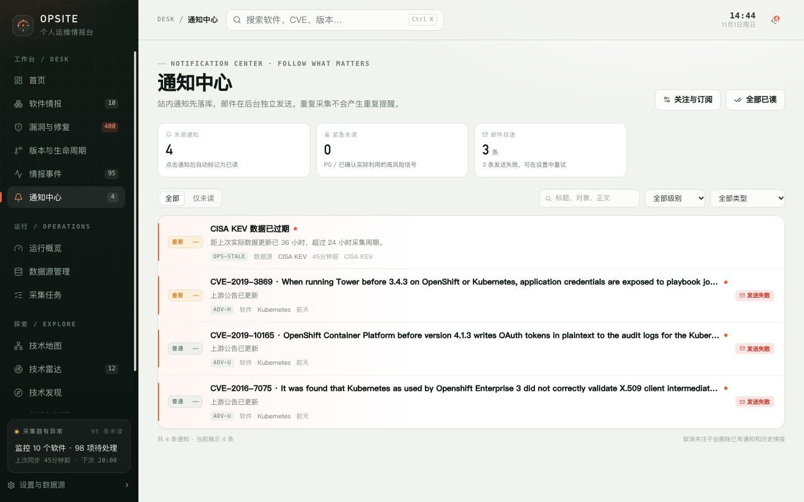

# 8. 关注、订阅与通知

Opsite 的通知由三层决定：

1. **关注对象**：谁的变化值得通知；
2. **订阅规则**：哪些事件类型需要提醒；
3. **投递通道**：站内通知、邮件，以及全局邮件开关和 SMTP。

理解这三层，可以避免“明明关注了却收不到”或“通知太多”的问题。

## 8.1 关注与订阅

页面标题为“关注与订阅”，展示四类关注对象：

- 软件（SW）；
- 雷达条目（RADAR）；
- 发现候选（DISC）；
- 漏洞公告（ADV）。

页面不展示数据源和采集任务的关注，它们由运行中心的异常通知覆盖。

### 操作

| 按钮 | 行为 |
| --- | --- |
| 关注发现流 | 关注技术发现流，接收新候选提醒 |
| 全局默认规则 | 编辑所有未单独设置规则的关注对象 |
| 打开 | 进入关注对象详情 |
| 规则 | 为该对象单独设置规则 |
| 取消关注 | 删除关注关系，但保留历史通知和事件 |

取消关注不会删除已有通知，也不会回滚已产生的情报事件。

## 8.2 规则编辑器

规则编辑器有 13 行事件类型，每行可以设置：

- **站内**：是否生成站内通知；
- **邮件**：是否发送邮件；
- **最低级别**：全部、重要及以上、仅紧急。

通知级别由服务端映射：

| 情报优先级 | 通知级别 |
| --- | --- |
| P0 | 紧急 |
| P1 | 重要 |
| P2 / P3 | 普通 |

### 事件类型与默认规则

| 事件类型 | 代码 | 默认站内 | 默认邮件 |
| --- | --- | --- | --- |
| 高风险漏洞 | ADV-H | 开 | 关 |
| 生命周期变化 | EOL | 开 | 关 |
| 新漏洞 | ADV | 关 | 关 |
| 公告更新 | ADV-U | 关 | 关 |
| 版本发布 | REL | 关 | 关 |
| 项目更新 | RAD | 关 | 关 |
| 发现候选 | DISC | 关 | 关 |
| 数据源异常 | OPS-SRC | 开 | 关 |
| 接口限流 | OPS-RATE | 开 | 关 |
| 任务失败 | OPS-TASK | 开 | 关 |
| 任务超时 | OPS-TIME | 开 | 关 |
| 数据过期 | OPS-STALE | 开 | 关 |
| 任务恢复 | OPS-REC | 开 | 关 |

默认只开高风险漏洞、生命周期变化和运行异常，避免首次使用时被版本发布和历史公告淹没。

### 全局默认与单对象规则

- 新关注的对象默认继承全局规则。
- 为单个对象保存规则后，会写入全部 13 类事件，该对象与全局规则完全脱钩。
- 即使你只改了一项，其余项也会按当前值固化，因此对象会显示“自定义规则”标签。
- 点击“恢复全局默认”会删除该对象的全部覆盖，而不是把值改回全局当前值。

规则变更只影响后续通知，不会补发或撤销已经产生的通知。

## 8.3 通知中心

页面显示：

| 指标 | 含义 |
| --- | --- |
| 未读通知 | 尚未阅读的站内通知数量 |
| 紧急未读 | 级别为紧急的未读通知数量 |
| 邮件投递 | 待发送、发送中和发送失败的数量 |

筛选：

- 全部 / 仅未读；
- 搜索标题、对象、正文；
- 级别：全部、紧急、重要、普通；
- 类型：全部或 13 类事件之一。

列表按“级别优先、时间倒序”排列。每条通知显示级别、标题、正文、规则代码、对象类型、对象名、时间、来源和邮件状态。

点击通知会标记为已读，并跳转到通知中的站内链接。右上角“全部已读”会把所有站内通知标为已读，不只当前筛选结果。

### 限制

- 页面一次加载最多 100 条通知，没有分页。
- 筛选在前端对已加载的 100 条进行，不是全库筛选。
- 邮件投递指标也只统计这 100 条内的投递状态。
- 站内通知未读数与情报事件未读数是两套独立计数。

## 8.4 通知抽屉

点击顶栏铃铛打开通知抽屉，显示最近 8 条通知：

- 级别、标题、对象名、类型、规则名和时间；
- 底部“通知中心”和“全部已读”；
- 点击通知同样标记已读、关闭抽屉并跳转。

“最近”仍按级别优先排序，不是纯时间顺序。

## 8.5 邮件设置

邮件配置在“设置 → 通知与邮件”。分为两部分，保存方式不同：

### 邮件通知

| 字段 | 说明 |
| --- | --- |
| 启用邮件通知 | 关闭后所有邮件投递标记为“已跳过”，站内通知不受影响 |
| 收件邮箱 | 个人收件地址；邮件通知关闭时禁用 |
| 发送方式 | 实时发送 / 每日摘要 |
| 摘要时间 | 仅每日摘要模式显示，默认 `09:00` |
| 免打扰时段 | 例如 `23:00-08:00`；实时邮件顺延到时段结束，摘要不受影响 |

这些字段属于设置页表单，需要点击页面底部“保存设置”才会生效。

### SMTP 服务器

| 字段 | 说明 |
| --- | --- |
| 启用 SMTP | 开启前需要主机、发件邮箱，以及有用户名时对应的密码 |
| SMTP 主机 | 例如 `smtp.example.com` |
| 端口 | 1–65535，默认 587 |
| 加密方式 | STARTTLS（587）、SSL / TLS（465）、不加密 |
| 用户名 | 可选 |
| 密码 | 已保存时留空表示不修改 |
| 发件人名称 | 默认 Opsite |
| 发件邮箱 | 发件地址 |

SMTP 配置有独立的“保存 SMTP”按钮，不随页面底部“保存设置”提交。修改后立即生效。

“发送测试邮件”使用**已保存**的 SMTP 配置和当前表单中的收件邮箱。未保存的 SMTP 修改不会用于测试。

密码使用 AES-256-GCM 加密存储，接口只返回是否已配置。密钥来自 `OPSITE_SECRET`，未配置时生成 `data/.secret`。迁移数据目录时必须保留密钥，否则已保存的密码无法解密。

## 8.6 邮件投递与重试

设置页底部显示最近 12 条邮件投递：

- 标题、状态、收件人、尝试次数；
- 创建时间、发送时间、下次尝试时间；
- 最后错误；
- 非“已发送 / 发送中”的记录可以手动重试。

状态包括：待发送、发送中、已发送、发送失败、已跳过。

失败会自动退避重试，最多 5 次，间隔为 1、5、15、60、180 分钟。以下情况会直接标记为跳过：

- 邮件通知已关闭；
- 收件邮箱未配置或格式不合法；
- SMTP 未配置或已停用；
- 收件邮箱为空。

## 8.7 推荐配置

第一次使用：

1. 保持默认站内规则，先把通知中心用起来；
2. 在“关注与订阅”中确认高风险漏洞和生命周期变化已开启；
3. 不需要邮件时不要启用 SMTP；
4. 需要邮件时，先填写收件邮箱和 SMTP，保存 SMTP，再发送测试邮件；
5. 邮件效果确认后，再逐项开启需要的邮件事件类型。

## 8.8 限制与注意事项

- 站内通知不依赖邮件通道；没有 SMTP 也能正常使用。
- 邮件依赖你自己的 SMTP 服务，后台队列要求 API 进程常驻。
- 没有浏览器 Web Push、桌面通知或移动端推送。
- 免打扰时段只延迟实时邮件，不影响站内通知和每日摘要。
- 免打扰格式非法时服务端会静默忽略，不会报错；建议严格使用 `HH:MM-HH:MM`。
- `DISABLE_EMAIL_QUEUE=true` 会停止后台邮件队列，但手动“重试”仍可触发队列处理。
- 单对象规则保存后与全局规则脱钩，后续修改全局默认不会影响它。

下一步：[技术雷达](09-radar.md)。
