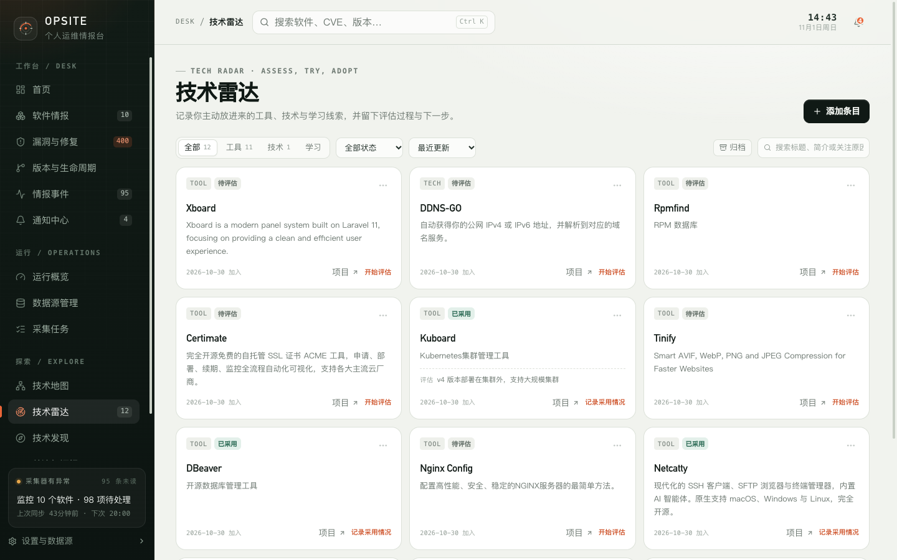

# 9. 技术雷达

技术雷达记录你主动放进来的工具、技术和学习线索，并保留评估过程。它不是自动推荐系统，也不会替你判断一项技术是否值得采用。

## 9.1 页面结构

页面顶部显示全部条目数量，并提供类型筛选：

| 类型 | 用途 |
| --- | --- |
| 工具 | 正在评估或准备采用的新工具 |
| 技术 | 值得跟进的技术方向或实践 |
| 学习 | 计划阅读、实践或补齐的知识 |

其他筛选和排序：

- 状态：全部状态、待评估、试用中、已采用、稍后关注、已忽略；
- 排序：最近更新、最近加入、最近评估；
- 搜索：标题、简介或关注原因；
- 归档视图：查看已归档条目。

右上角“添加条目”打开新建弹窗。

## 9.2 添加条目

| 字段 | 必填 | 说明 |
| --- | --- | --- |
| 标题 | 是 | 例如 `Cilium Gateway API` |
| 类型 | 是 | 工具、技术、学习 |
| 为什么关注 | 否 | 评估背景、待验证问题或下一步动作；建议填写 |
| 参考链接 | 否 | HTTP/HTTPS 链接 |

新条目默认状态为“待评估”。

## 9.3 状态与流转

| 状态 | 含义 |
| --- | --- |
| 待评估 | 刚加入，尚未开始判断 |
| 试用中 | 正在验证，尚未决定 |
| 已采用 | 已决定采用或落地 |
| 稍后关注 | 暂不投入，但保留线索 |
| 已忽略 | 明确不采用 |

可用的状态操作：

| 当前状态 | 可以转到 |
| --- | --- |
| 待评估 | 试用中、稍后关注、已忽略 |
| 试用中 | 已采用、待评估、稍后关注 |
| 已采用 | 试用中 |
| 稍后关注 | 待评估 |
| 已忽略 | 待评估 |

状态变化会记录为一条“状态变更”记录，历史评估记录不会丢失。

## 9.4 卡片与快捷操作

卡片显示：

- 类型代码（TOOL / TECH / LEARNING）；
- 当前状态；
- 标题和简介；
- 加入时间；
- 最新一条记录和下一步行动；
- 项目链接（如果填写）。

不同状态的主操作不同：

| 状态 | 主操作 |
| --- | --- |
| 待评估 | 开始评估 |
| 试用中 | 记录试用结果 |
| 已采用 | 记录采用情况 |
| 稍后关注 | 重新评估 |
| 已忽略 | 恢复关注 |

## 9.5 条目详情

详情页显示：

- 标题、类型、状态、加入时间、最近更新和最近评估时间；
- 参考链接；
- 评估记录时间线；
- 基本信息；
- 后续计划 / 下一步行动。

评估记录类型：

| 类型 | 用途 |
| --- | --- |
| 评估记录 | 判断是否值得投入 |
| 试用记录 | 记录验证过程和结果 |
| 采用记录 | 记录落地情况 |
| 备注 | 补充背景或问题 |
| 状态变更 | 由状态操作自动生成 |

添加记录时可以填写：

- 记录类型；
- 记录内容；
- 下一步行动（可选）。

记录一旦写入就会保留在时间线中，适合记录“为什么当时这样判断”。

## 9.6 归档、恢复与删除

- **归档**：从主列表移出，状态和记录保留；可以在归档视图恢复。
- **恢复**：回到雷达列表，原状态和历史记录不变。
- **永久删除**：连同全部评估记录一起删除，无法恢复。

如果只是暂时不关注，优先使用“稍后关注”或“归档”，不要直接删除。

## 9.7 与技术地图、知识库的关系

- 雷达条目可以关联到技术节点，成为节点详情中的“关联雷达条目”。
- 技术发现候选可以导入雷达，之后在雷达中维护评估记录。
- 个人笔记可以关联技术节点和软件；如果要记录雷达评估的长背景，可以在笔记中引用，但不会形成到雷达条目的直接关联。

## 9.8 限制

- 雷达不自动评估技术，也不提供评分或推荐结论。
- 状态流转是固定的，不能自定义状态。
- 归档和删除是不同操作；删除不可恢复。
- 雷达条目不会自动同步上游版本或安全公告，它只记录你的判断过程。

下一步：[技术发现](10-discovery.md)。
