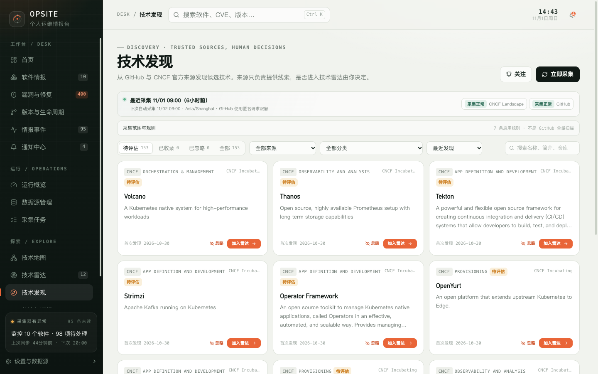

# 10. 技术发现

技术发现从 GitHub 和 CNCF Landscape 的公开来源中收集候选项目，再由你决定是否把它加入技术雷达。

来源只负责提供线索，不替你做选型决定。

## 10.1 页面结构

页面顶部显示最近一次采集时间、下次采集时间、采集范围和各来源状态：

| 来源状态 | 含义 |
| --- | --- |
| 尚未采集 | 还没有执行过 |
| 采集正常 | 最近一次采集成功 |
| 部分规则失败 | 部分关键词或规则失败 |
| 采集失败 | 最近一次采集整体失败 |

“采集范围与规则”展示当前启用的发现规则。规则决定从 GitHub 搜索哪些关键词和主题，CNCF 来源则使用官方 Landscape 数据。

页面还显示最近任务的状态、错误和结果。右上角“立即采集”触发一次手动采集。

## 10.2 默认来源

| 来源 | 说明 |
| --- | --- |
| GitHub | 通过 GitHub 搜索 API 按关键词和主题规则发现仓库 |
| CNCF Landscape | 来自 CNCF 官方公开数据中的毕业与孵化项目 |

默认每天 09:00（`Asia/Shanghai`）自动采集一次。可以通过 `DISCOVERY_ENABLED=false` 关闭自动采集，手动采集仍然可用。

## 10.3 候选状态

| 状态 | 含义 |
| --- | --- |
| 待评估 | 尚未做决定，可以加入雷达、继续观察或忽略 |
| 已收录 | 已进入技术雷达，后续在雷达中维护评估记录 |
| 已忽略 | 不再出现在待评估列表，来源数据和首次发现时间仍保留 |

采集只更新候选的外部字段，不会覆盖你的收录或忽略决定。

## 10.4 筛选与排序

- 状态：待评估、已收录、已忽略、全部；
- 来源：全部、GitHub、CNCF Landscape；
- 分类：全部或具体分类；
- 排序：最近发现、来源最近更新、Star 数、名称；
- 搜索：名称、简介、仓库。

候选卡片显示：

- 来源分类和来源名称；
- 状态；
- 项目名称和简介；
- GitHub Star / Fork（如果有）；
- 首次发现时间；
- 关联的雷达条目（如果已收录）；
- “忽略”和“加入雷达”按钮。

## 10.5 加入技术雷达

点击“加入雷达”会打开导入弹窗：

| 字段 | 说明 |
| --- | --- |
| 雷达标题 | 默认使用候选名称，可修改 |
| 关注原因或简介 | 默认使用候选简介，可补充 |
| 类型 | 工具、技术、学习 |
| 链接 | 项目链接，默认使用候选仓库或主页 |

如果技术雷达中已经存在相同链接的条目，弹窗会提示“关联已有雷达条目”，不会创建重复条目。关联后候选显示为已收录。

导入后：

- 候选状态变为“已收录”；
- 技术雷达中新增一条“待评估”条目；
- 后续评估、试用和采用记录在技术雷达中维护；
- 技术发现中的来源信息仍然保留。

## 10.6 候选详情

详情页展示：

- 名称、简介、状态；
- 首次发现、最近发现时间；
- 所有发现来源及来源引用；
- 来源最近更新、最近成功发现、最近抓取等时间；
- 收录决定：已收录时链接到雷达条目；
- 项目信息：分类、主要语言、许可证、项目链接、主页；
- GitHub 指标（如果来源提供）。

如果候选已关联到雷达条目，详情页不会再次创建重复条目，而是提示到雷达中维护评估记录。

## 10.7 忽略与恢复

- 忽略后候选从待评估列表移出，但来源记录和首次发现时间保留。
- 已忽略的候选可以恢复为待评估。
- 已收录的候选不会因为再次采集而回退状态。

## 10.8 采集规则与限制

- GitHub 来源不是全量扫描，只使用已启用的规则。
- 规则失败时，其他规则仍可能成功，页面显示“部分规则失败”。
- 采集受 GitHub API 速率限制影响；配置 `GITHUB_TOKEN` 可以提高上限。
- CNCF 来源依赖官方 Landscape 数据的可访问性。
- 自动采集受 `DISCOVERY_ENABLED` 和调度器状态影响；手动采集不受 `DISCOVERY_ENABLED=false` 阻止。
- 候选数量较多时，用来源、分类和搜索缩小范围。

## 10.9 限制

- 来源只提供候选，不验证项目质量、维护状态或安全性。
- 不提供全 GitHub 搜索或自定义任意查询；只能使用已配置规则。
- 导入雷达后，技术发现中的候选不会再自动同步雷达状态以外的评估结论。
- 忽略不会删除来源数据，但不会继续出现在待评估列表。

下一步：[我的知识库](11-knowledge.md)。
