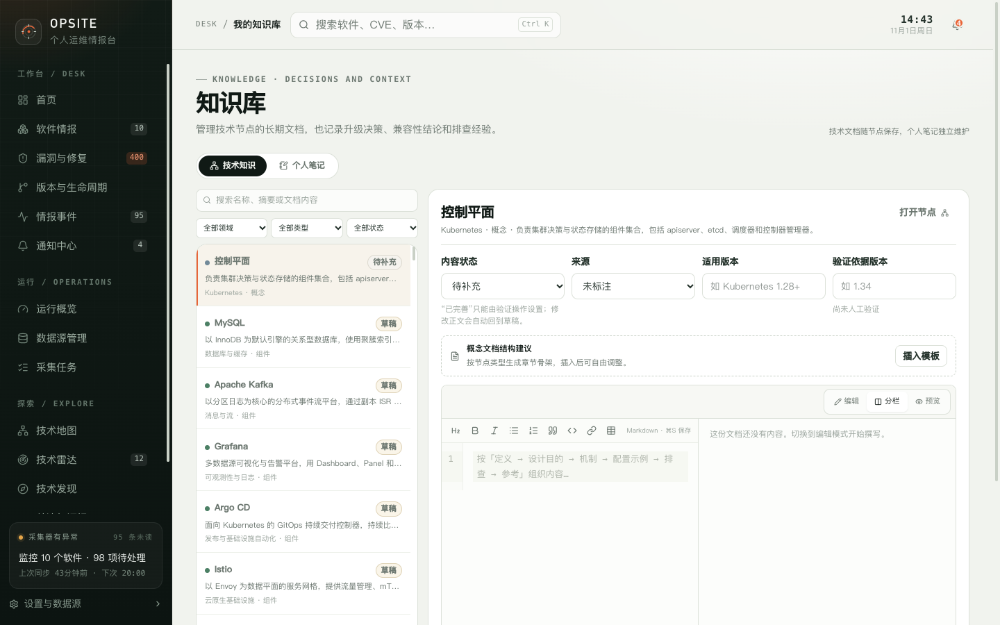

# 11. 我的知识库

知识库分为两个标签页：

- **技术知识**：技术地图中每个节点的长期 Markdown 文档；
- **个人笔记**：独立的笔记，可以关联技术节点和软件。

二者都保存在本地 SQLite，不会上传到外部服务。

## 11.1 技术知识

技术知识标签页左侧是节点列表，右侧是文档编辑器。

### 筛选与搜索

- 搜索名称、摘要或文档内容；
- 按领域筛选；
- 按节点类型筛选（概念、组件、资源、协议、实践、方向）；
- 按文档状态筛选（待补充、草稿、待核实、已完善）；
- 额外提供“长期未验证（> 180 天）”筛选。

列表显示节点名称、文档状态、摘要、所属领域和类型。

### 编辑器

选中节点后，右侧显示：

- 节点名称、领域、类型和摘要；
- “打开节点”链接；
- 内容状态；
- 来源；
- 适用版本；
- 验证依据版本；
- Markdown 编辑 / 分栏 / 预览；
- 插入模板；
- 验证知识；
- 保存。

### 内容状态

| 状态 | 含义 |
| --- | --- |
| 待补充 | 还没有正文 |
| 草稿 | 已有正文，尚未完成验证 |
| 待核实 | 内容需要复核 |
| 已完善 | 已通过“验证知识”确认 |

规则：

- “已完善”不能直接在下拉框中选择，只能通过“验证知识”设置。
- 修改已完善文档的正文，会自动回到“草稿”。
- 验证前会先保存当前正文。
- 验证需要正文非空，并填写本次实际验证的版本。

### 自动保存

技术文档在停止输入约 1.4 秒后自动保存。页面底部显示：

- 保存中；
- 已保存；
- 有未保存的更改；
- 保存失败；
- 内容更新时间。

按 `Ctrl/Cmd + S` 或点击“保存”可以立即保存。切换节点时如果有未保存内容，系统会先尝试保存；保存失败会停留在当前节点。

### 插入模板

当正文为空时，可以按节点类型插入章节骨架。模板只提供结构，不会生成技术结论。插入后可以自由修改。

## 11.2 个人笔记

个人笔记适合记录：

- 升级评估；
- 兼容性结论；
- 排障过程；
- 决策背景和后续动作。

### 新建与编辑

点击“新建笔记”进入编辑状态：

| 字段 | 说明 |
| --- | --- |
| 标题 | 必填 |
| 正文 | Markdown，支持编辑 / 分栏 / 预览 |
| 关联技术节点 | 可选，按领域分组选择 |
| 关联软件 | 可选 |
| 标签 | 逗号分隔，例如“升级, 兼容性” |

新建笔记需要点击“保存”才会创建。已有笔记在停止输入约 1.2 秒后自动保存，也可以手动保存。

### 搜索与删除

- 搜索标题、正文、标签、关联节点和关联软件；
- 笔记列表显示标题、摘要、关联节点、关联软件和前两个标签；
- 删除笔记不可恢复，但不会影响关联的软件、技术节点或其他情报。

## 11.3 技术知识与个人笔记的区别

| 维度 | 技术知识 | 个人笔记 |
| --- | --- | --- |
| 归属 | 技术地图节点 | 独立笔记 |
| 主要用途 | 长期维护的结构化文档 | 记录决策、经验和上下文 |
| 元数据 | 内容状态、来源、适用版本、验证版本 | 标题、标签、关联对象 |
| 验证 | 有“验证知识”和“已完善”状态 | 无验证状态 |
| 自动保存 | 约 1.4 秒 | 已有笔记约 1.2 秒；新建需手动保存 |

## 11.4 与软件、雷达、技术地图的关系

- 技术知识直接属于技术节点，软件详情可以显示关联节点。
- 个人笔记可以关联技术节点和软件，但不能直接关联雷达条目或发现候选。
- 技术雷达的评估记录保存在雷达条目中，不写入知识库。
- 技术发现的候选信息保存在发现模块，导入雷达后在雷达中维护。

## 11.5 限制

- 知识库没有多人协作、评论或版本历史。
- Markdown 内容是纯文本，不执行脚本或嵌入外部应用。
- “长期未验证”按上次验证时间计算；从未验证的文档不会被这个筛选命中。
- 文档状态是自我管理的工作流，不代表内容已经过外部审核。
- 删除笔记不可恢复。

下一步：[技术地图](12-tech-map.md)。
