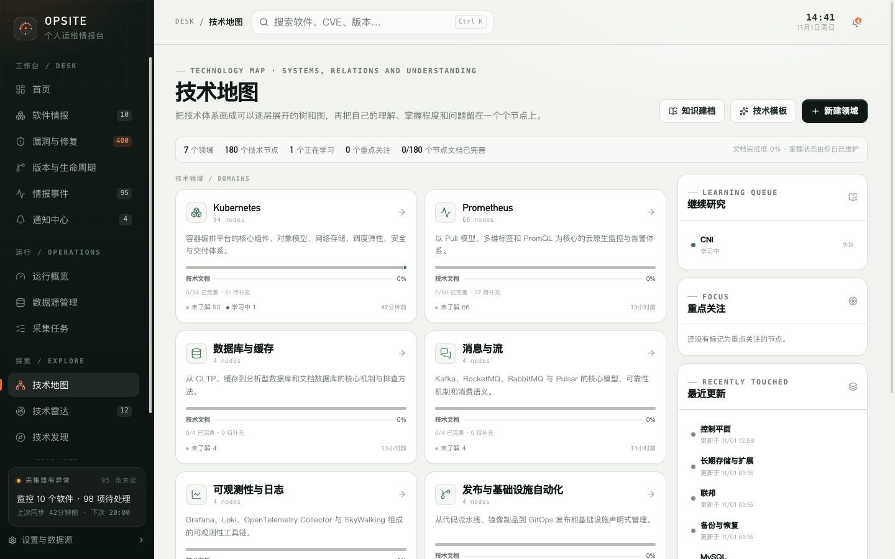
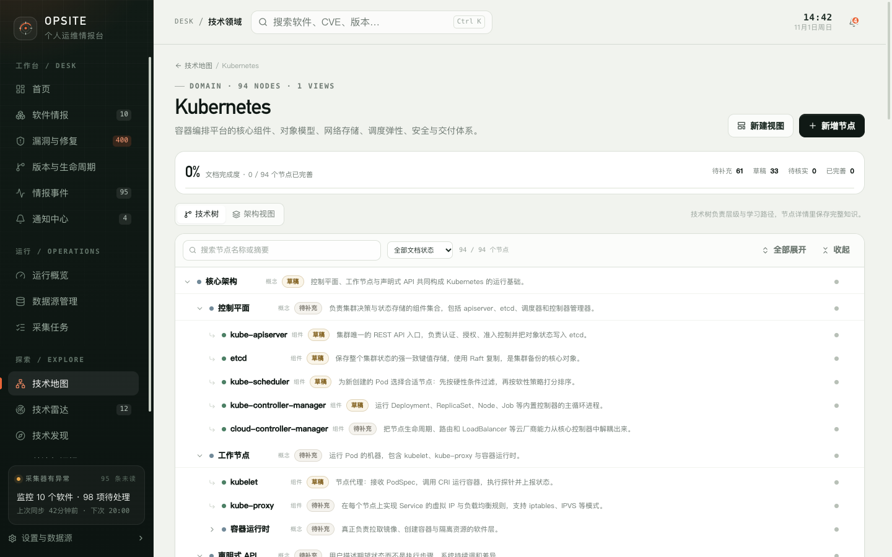
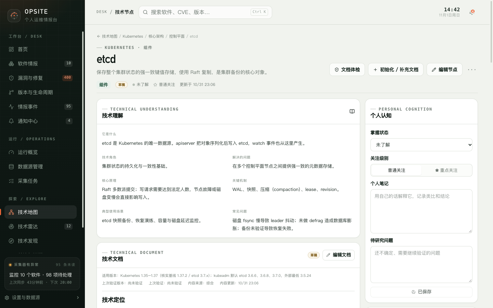

# 12. 技术地图

技术地图用“领域 → 技术树 → 节点”组织你的技术体系，并用架构视图表达组件之间的关系。它不是为了画一张好看的图，而是为了让学习状态、文档和待研究问题有固定的落点。

## 12.1 技术地图总览

总览页显示：

- 技术领域数量；
- 技术节点总数；
- 正在学习的节点数；
- 重点关注的节点数；
- 文档完成度（已完善节点占有效节点的比例）。

页面还提供三个辅助区块：

| 区块 | 内容 |
| --- | --- |
| 继续研究 | 掌握状态为“学习中”的节点 |
| 重点关注 | 关注级别为“重点关注”的节点 |
| 最近更新 | 最近修改的节点 |

顶部按钮：

- **知识建档**：进入批量初始化文档的流程；
- **技术模板**：查看内置技术模板；
- **新建领域**：创建自定义技术领域。

## 12.2 技术领域

每个领域是一张卡片，显示：

- 领域名称和简介；
- 节点数量；
- 文档完成度；
- 已完善、待补充等状态计数；
- 最近更新时间。

点击进入领域详情。内置领域包括 Kubernetes、Prometheus、数据平台、消息与流、可观测性与日志、发布与基础设施自动化、云原生基础设施等；具体以当前数据库中的内容为准。

## 12.3 领域详情：技术树与架构视图

领域页有两个视图：

| 视图 | 用途 |
| --- | --- |
| 技术树 | 维护层级、学习路径和节点文档 |
| 架构视图 | 用节点和连线表达组件关系 |

技术树支持：

- 按节点名称或摘要搜索；
- 按文档状态筛选（全部、待补充、草稿、待核实、已完善）；
- 全部展开 / 收起；
- 新增节点；
- 新建视图；
- 打开节点详情。

每个节点显示类型、文档状态和摘要。树形结构适合表达“包含”和层级关系；跨组件的依赖、替代、实现关系应放在架构视图或节点关系中。

### 文档完成度

领域顶部的完成度按节点文档状态计算：

- 待补充：还没有正文；
- 草稿：已有正文，但未完成验证；
- 待核实：内容需要复核；
- 已完善：已完成并验证。

完成度只统计有效节点，不把归档节点计入。

## 12.4 节点类型

| 类型 | 用途 |
| --- | --- |
| 领域 | 一级技术方向 |
| 概念 | 抽象概念、模型、原则 |
| 组件 | 可部署或可运行的软件组件 |
| 资源 | 对象模型中的资源类型 |
| 协议 | 通信协议和交互规范 |
| 实践 | 操作流程、方法和经验 |
| 方向 | 仍在演进的技术方向 |

类型会影响技术文档模板的默认章节。例如组件模板强调职责、工作原理、关键配置和故障排查；实践模板强调前提、步骤、验证和回滚。

## 12.5 节点详情

节点详情由三部分组成：

1. **技术理解**：结构化的客观知识；
2. **个人认知**：你的掌握状态、关注级别、笔记和待研究问题；
3. **技术文档**：长期维护的正文。

### 技术理解

内置节点通常包含：

- 它是什么；
- 技术角色；
- 解决的问题；
- 核心原理；
- 关键机制；
- 典型使用场景；
- 常见问题。

这些字段用于快速理解节点，不替代技术文档。内置内容不会根据采集结果自动修改。

### 个人认知

| 字段 | 取值 |
| --- | --- |
| 掌握状态 | 未了解、待学习、学习中、已了解、已掌握、深入研究 |
| 关注级别 | 普通关注、重点关注 |
| 个人笔记 | 自由文本，记录类比、结论和疑问 |
| 待研究问题 | 尚未确认、需要继续验证的问题 |

个人认知只属于你，不会被知识建档覆盖。

### 技术文档

技术文档支持：

- 文档状态：待补充、草稿、已完善、待核实；
- 适用版本；
- 验证依据版本；
- 上次验证时间；
- 内容来源：官方文档、实践经验、整理归纳、综合；
- 正文编辑和预览；
- 文档体检；
- 初始化 / 补充文档。

“已完善”只能由验证操作设置，不能仅靠修改正文自动获得。编辑器不会因为写了内容就把草稿改成已完善。

## 12.6 节点关系与关联

节点可以建立关系，例如：

- 包含；
- 依赖；
- 基础于；
- 扩展；
- 替代；
- 实现；
- 关联。

节点还可以关联：

- 软件条目；
- 技术雷达条目；
- 技术发现候选；
- 知识库笔记。

关联后，软件详情可以显示相关技术知识，节点也能看到关联软件的最新事件。

关系由你维护，系统不会自动推断。链接可达或名称相似不代表关系成立。

## 12.7 架构视图

架构视图用节点和连线展示技术体系。适合表达：

- 组件依赖；
- 请求链路；
- 部署拓扑；
- 技术替代关系。

视图类型包括架构视图、流程图、关系图和部署视图。视图保存采用**整张图覆盖**：同一时间建议只在一个标签页编辑同一张视图，否则后保存的版本会覆盖先保存的版本。

## 12.8 内置内容与自定义内容

- 内置 Kubernetes、Prometheus 等知识内容随版本提供，不会因上游采集结果自动修改。
- 你可以编辑节点、补充文档、建立关系和自定义视图。
- 新建节点和文档属于本地数据，升级不会覆盖。
- 知识建档只初始化空文档或补充缺失章节，不覆盖已有正文。

## 12.9 限制

- 没有多人实时协同编辑。
- 架构视图没有版本历史或冲突合并，保存即覆盖。
- 系统不会自动推断技术关系。
- 内置技术内容需要人工核实，链接可达不等于结论正确。
- 文档完成度是节点状态统计，不代表内容质量已经过外部审核。
- 没有自动把采集到的软件版本写入技术文档的机制。

下一步：[知识建档与文档体检](13-knowledge-build.md)。
