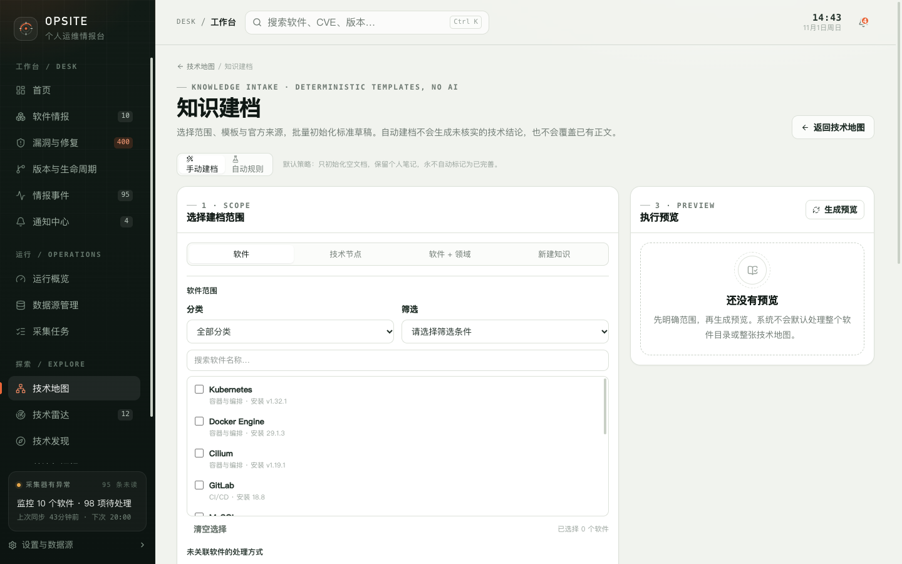

# 13. 知识建档与文档体检

知识建档用于批量创建结构一致的技术文档草稿，文档体检用于检查已有文档是否满足维护要求。两者都不生成技术结论，也不会替你判断内容是否正确。

知识建档有两种模式：

| 模式 | 用途 |
| --- | --- |
| 手动建档 | 明确选择一次范围，预览后执行 |
| 自动规则 | 在之后新增软件或技术节点时，按规则初始化文档 |

页面固定提示：默认策略只初始化空文档，保留个人笔记，永不自动标记为“已完善”。

## 13.1 入口

技术地图总览的“知识建档”按钮进入本页。技术节点详情中的“初始化 / 补充文档”会带上当前节点，直接定位到该节点的建档范围。

## 13.2 手动建档：选择范围

手动模式分四类范围：

| 范围 | 说明 |
| --- | --- |
| 软件 | 按软件条目建档；未关联技术节点的软件需要额外指定处理方式 |
| 技术节点 | 直接为已有技术节点初始化或补充文档 |
| 软件 + 领域 | 同时处理软件范围和技术节点范围 |
| 新建知识 | 先创建一个技术节点，再初始化它的文档 |

### 软件范围

可选择：

- 分类；
- 筛选条件：全部软件（需确认范围）、未关联技术节点、已关联但无文档、已关联且为草稿；
- 搜索并勾选具体软件；
- 清空选择。

软件列表最多显示 200 条匹配结果，归档软件不在列表中。点击“全部软件”只是一个筛选条件，执行前仍需在预览中确认范围；系统不会因为页面加载了软件目录就默认处理全部软件。

### 未关联软件的处理方式

当软件还没有关联技术节点时，可以在本页统一决定：

| 字段 | 取值 |
| --- | --- |
| 目标领域 | 具体领域，或“未指定（生成待办）” |
| 处理方式 | 新建节点并关联、关联现有节点、不自动决定（生成待办） |
| 父节点 | 领域根节点或该领域下的节点 |
| 节点类型 | 概念、组件、资源、协议、实践、方向 |

选择“关联现有节点”时，可以勾选“关联现有节点时，若该节点没有正文，同时初始化标准草稿”。已有正文仍然不会被覆盖。

目标领域未指定、父节点无法确定或存在多个可选节点时，系统会生成待处理项，而不是猜测。

### 技术节点范围

可按领域、节点类型、父节点筛选，并选择文档筛选条件：

| 文档筛选 | 含义 |
| --- | --- |
| 全部节点（需确认范围） | 不按文档状态筛选 |
| 仅无文档 | 只有正文为空的节点 |
| 仅草稿 | 内容状态为草稿的节点 |
| 仅待核实 | 内容状态为待核实的节点 |

节点列表最多显示 300 条。勾选“包含父节点的整个子树”后，父节点范围会扩展到整棵子树。

### 新建知识

需要填写：

| 字段 | 必填 | 说明 |
| --- | --- | --- |
| 节点名称 | 是 | 例如 `Raft 共识` |
| 目标领域 | 是 | 新节点所属领域 |
| 父节点 | 否 | 默认挂在领域根节点下 |
| 节点类型 | 是 | 决定默认文档模板 |
| 节点摘要 | 否 | 最多 500 字符，只填写已确认的事实 |

范围和名称不完整时，服务端会拒绝生成预览。

### 范围校验

服务端要求每次执行都有明确范围：

- 软件范围不能完全为空，必须至少选择软件、分类或筛选条件；
- 节点范围不能完全为空，必须至少选择节点、领域、父节点、类型或文档筛选；
- 组合范围至少要有软件侧或节点侧的一个条件；
- 新建知识必须指定领域和节点名称。

## 13.3 模板与官方来源

### 文档模板

内置五套固定模板：

| 模板 | 适用对象 |
| --- | --- |
| 软件 / 组件型 L2 | 具体软件、组件或运行时 |
| 技术概念型 L2 | 概念、模型或机制 |
| 协议型 L2 | 通信协议、接口规范或数据交换格式 |
| 资源对象型 L2 | API 对象、资源模型或配置实体 |
| 实践方法型 L2 | 方法、流程或运维实践 |

每套模板包含 8 个固定章节，顺序为：技术定位、设计原理、工作机制、关键配置与实践、版本差异与兼容性、常见问题与限制、技术关联、参考资料。模板只写入章节骨架和写作提示，不填技术结论。

新建知识时会按节点类型选择默认模板，也可以手动改选。

### 官方文档与参考来源

- “官方文档地址”可选，但文档体检要求至少两个可用的 HTTPS 官方来源；
- “参考来源”由“来源名称 + URL”组成，至少同时填写两项才会提交；
- 来源必须是 HTTPS、443 端口，且不能包含用户名、密码；
- 官方文档地址与参考来源重复时，重复项不会写入。

### 检查链接

“检查链接”只做可达性检查：

- 只接受 HTTPS；
- 固定 DNS 解析结果，阻止 localhost、私有地址、保留地址和云元数据地址；
- 超时 8 秒，最多跟随 3 次重定向；
- 最多 4 个并发请求，响应体上限 256 KB。

检查结果不会修改节点、文档状态或验证记录。链接可访问也不代表技术结论正确。

### 处理过滤

| 选项 | 默认 | 说明 |
| --- | --- | --- |
| 仅处理无文档项 | 关闭 | 跳过已有正文的目标 |
| 仅处理草稿 | 关闭 | 只处理草稿状态 |
| 跳过已验证项 | 开启 | 有验证记录的目标不再处理 |
| 永不覆盖已有正文 | 固定开启 | 不可关闭 |
| 仅处理活跃项，跳过归档 | 固定开启 | 归档软件和节点不处理 |

还可以填写排除软件 ID 和排除节点 ID，支持逗号、空格或中文逗号分隔。ID 可在对应详情页或接口数据中查看，普通使用时通常不需要填写。

## 13.4 生成预览

点击“生成预览”后，系统按当前范围和过滤条件计算将要发生的变化，并显示：

- 选中软件、选中节点；
- 新建节点、关联现有、关联并初始化、初始化文档；
- 跳过、待人工决定；
- 缺少官方来源。

预览还会给出警告，例如：

- 部分目标缺少两个可用的 HTTPS 官方来源；
- 存在需要人工决定的项，系统不会猜测领域、父节点或关联方式；
- 新建节点和文档会保存为草稿，不会自动标记为已完善；
- 预览只检查结构，链接可达性与技术正确性需要另行核实。

预览最多显示前 120 项，总数仍按实际结果统计。

预览有效期为 10 分钟，且只能执行一次。修改范围、模板、来源或过滤条件后，页面会清除旧预览，需要重新生成；服务端也会校验范围快照，数据变化时返回冲突错误。

## 13.5 执行建档

预览下方必须勾选确认：

> 我确认以上范围。执行只初始化空文档，不覆盖已有 Markdown、不修改个人笔记、不自动标记为已完善。

确认后才能点击“执行建档”。

执行结果按以下状态统计：

| 状态 | 含义 |
| --- | --- |
| 已创建 | 新建了技术节点 |
| 已关联 | 软件与现有节点建立了关联 |
| 已初始化 | 为空文档写入了模板骨架 |
| 已跳过 | 已有正文、非草稿、已验证或不符合过滤条件 |
| 待补充 | 需要人工决定，已进入待处理列表 |
| 失败 | 单项执行出错 |

执行完成后预览即失效，不能重复提交。部分项失败不会回滚已成功的项。

## 13.6 自动规则

自动模式默认关闭。规则只在**之后新增**软件或技术节点时运行，不会回填历史数据。

### 规则字段

| 字段 | 说明 |
| --- | --- |
| 规则名称 | 必填 |
| 触发方式 | 新增软件时、新增技术节点时 |
| 模板 | 五套内置模板之一 |
| 软件分类筛选 | 仅“新增软件时”可用，可留空表示全部分类 |
| 目标领域 | 软件触发时用于决定新节点归属；留空会生成待办 |
| 关联策略 | 新建节点并关联、关联现有节点、不自动决定（生成待办） |
| 节点类型 | 新建节点的类型 |
| 父节点 | 可选，默认领域根节点 |
| 官方文档地址 | 可选的规则来源 |
| 规则来源 | 来源名称和 URL |

节点触发的规则还可以按领域和节点类型筛选。

### 运行行为

- 规则只在真实创建事件后运行，失败不会阻断软件或节点创建；
- 无法确定领域、父节点或关联方式时，生成待处理项；
- 同名节点不会按名称自动合并；
- 软件已关联多个节点时，不会擅自选择其中一个；
- 目标领域归档、父节点非法等情况同样要求人工处理；
- 已创建的节点和文档不会因为后续修改规则而被回填或重写。

规则列表显示启用状态、触发方式、模板、策略、最近运行时间和结果。可以编辑、暂停、启用或删除规则。删除规则不会删除已创建的节点和文档。

### 待处理建档项

待处理项显示软件或节点名称及原因，可以：

- **手动处理**：跳转到知识建档页并带上对应软件或节点；
- **忽略**：从待处理列表移除，不创建文档。

## 13.7 永不覆盖的边界

无论手动还是自动，建档都遵守以下边界：

- 已有正文一律跳过，不覆盖 Markdown；
- 不修改个人笔记、掌握状态、关注级别或待研究问题；
- 不删除或改写已有验证记录；
- 不会把文档自动标记为“已完善”；
- 只在官方文档或代码仓库字段为空时填入来源；
- 参考链接只追加并去重；
- 不自动建立技术关系，不按名称推断关联；
- 不生成未核实的技术结论，也不调用 AI 补全内容。

建档生成的是**草稿**。需要在技术节点或知识库中继续补充、核实并执行“验证知识”。

## 13.8 文档体检

技术节点详情中的“文档体检”对当前节点做只读检查，不修改正文、状态或验证记录。

检查项包括：

| 检查 | 结果 |
| --- | --- |
| 正文非空 | 空正文不通过 |
| 8 个固定章节齐全且顺序正确 | 缺章或顺序错误不通过 |
| 正文长度 | L2 节点少于 1,500 字符不通过；根节点少于 1,500 字符为警告 |
| 版本差异与兼容性章节 | 缺少时不通过 |
| 适用版本 | 缺失或未写入为警告；写成 `latest` 或“最新”不通过 |
| 来源协议 | 非 HTTPS 或格式不合法不通过 |
| 官方来源数量 | 少于两个可用 HTTPS 来源不通过 |
| 占位内容 | 含 TODO、TBD、请填写、待补充、需要补充说明为警告 |
| 内容来源 | 未标注为警告 |
| 技术关联 | 没有关系且未人工确认独立为警告 |
| 软件关联 | 组件节点未关联软件为警告 |
| 验证记录 | 状态为“已完善”但没有验证记录不通过 |

结果分为“通过”“有警告”“不通过”，并列出对应章节和片段。

> 当前页面的“文档体检”只提交节点 ID，不检查来源链接当前是否可达。后端支持可达性检查，但界面未启用该选项。

文档体检不会因为正文里出现“独立”等字样就认定节点独立；只有节点详情中人工确认独立并填写原因，才会通过“技术关联”检查。

## 13.9 限制

- 不调用 AI，不自动撰写或补全技术内容。
- 只初始化空文档，不改善已有正文的质量。
- 不回溯历史软件和节点。
- 不自动推断领域、父节点、关联方式或技术关系。
- 不按名称合并节点或软件。
- 不把上游版本、漏洞或生命周期数据写入技术文档。
- 预览过期或数据变化后必须重新生成。
- 执行是逐项进行的，部分失败不会整体回滚。
- 文档体检是结构检查，不代表内容已经过外部审核。

返回[用户手册目录](README.md)。
