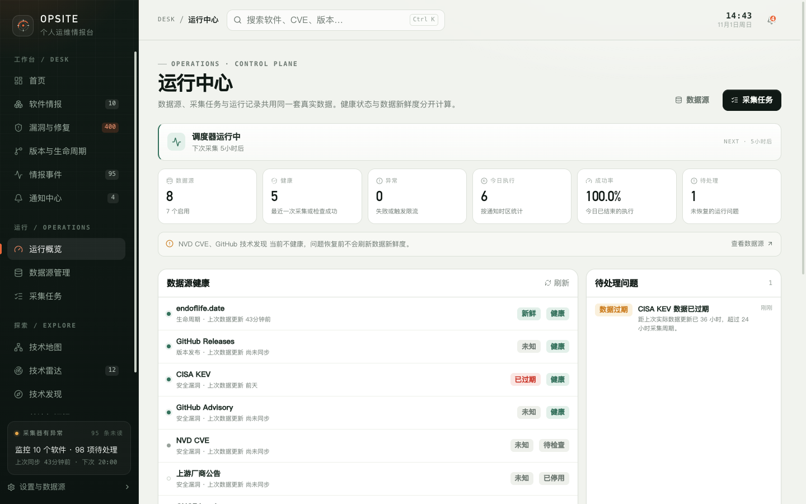

# 14. 运行中心、设置与故障排查

本章说明数据源和采集任务的状态含义、设置页的各项配置、备份恢复步骤，以及常见故障的排查顺序。



## 14.1 运行中心

“运行概览”页面每 5 秒刷新，展示调度器、数据源健康、待处理问题和最近执行。

### 调度器横幅

| 状态 | 含义 |
| --- | --- |
| 调度器运行中 | 有启用的任务和数据源，按 cron 计划执行 |
| 调度器已暂停 | 设置了 `DISABLE_SCHEDULER=true`，或没有可调度的任务 |

横幅会显示下次采集时间。暂停时定时采集不会触发，但手动执行仍然可用。

### 指标

| 指标 | 含义 |
| --- | --- |
| 数据源 | 全部数据源数量，脚注显示启用数量 |
| 健康 | 启用且最近一次采集或检查成功 |
| 异常 | 启用且状态为失败或触发限流 |
| 今日执行 | 按通知时区计算的当日运行记录数 |
| 成功率 | 当日已结束执行中成功所占比例；没有记录显示 `—` |
| 待处理 | 尚未恢复的运行问题数量 |

### 数据源健康

列表展示全部数据源，包括停用的。每行显示健康状态、数据新鲜度、上次数据更新、连续失败次数和最近错误。

“健康”和“新鲜度”是两件事：

- **健康**看最近一次采集或检查是否成功；
- **新鲜度**看实际数据距离上次更新过了多久。

因此可能出现“健康但已过期”：采集一直成功，但上游没有新数据，实际数据更新时间没有推进。

新鲜度阈值：

- 新鲜：未超过预期更新周期；
- 临近过期：进入宽限期；
- 已过期：超过周期加宽限期；
- 未知：未启用新鲜度跟踪、没有数据更新时间或周期无效。

### 待处理问题

最多显示 8 条，按紧急程度和最近出现时间排序。问题类型包括：

- 数据源异常；
- 接口限流；
- 任务失败；
- 任务超时；
- 数据过期；
- 调度异常。

点击问题可以跳到关联的数据源或任务。

### 最近执行

最多显示 8 条，包含任务、数据源、状态、触发方式、新增/更新数量、耗时和开始时间。

## 14.2 数据源管理

数据源是全局采集适配器。列表支持按状态、类型和名称筛选，并可以执行“检查”和“采集”。

### 内置数据源

| 数据源 | 类型 | 默认状态 |
| --- | --- | --- |
| endoflife.date | 生命周期 | 启用 |
| GitHub Releases | 版本发布 | 启用 |
| GitHub Advisory | 安全漏洞 | 启用 |
| NVD CVE | 安全漏洞 | 启用 |
| CISA KEV | 安全漏洞 | 启用 |
| 上游厂商公告 | 安全漏洞 | 停用，尚未接入 |
| GitHub 技术发现 | 技术发现 | 启用 |
| CNCF Landscape | 技术发现 | 启用 |

> “上游厂商公告”适配器尚未接入具体厂商 API，默认停用。启用前请确认对应版本已经实现该能力。

### 检查与采集

- **检查**：对数据源做一次网络探测，验证连通性和配额，不写入业务数据。
- **采集**：触发该数据源关联的任务，执行真实采集。

同一时间只允许一个采集任务运行。已有任务执行中时，再次触发会提示稍后再试。

### 数据源详情

详情页显示：

- 健康状态、新鲜度、最近成功/失败和连续失败次数；
- 实际数据更新时间、数据年龄、最近检查；
- 配额和限流记录（仅在上游提供真实配额时）；
- 最近 30 条健康检查记录；
- 关联任务；
- 最近 20 条执行记录。

可编辑项只有：

- 启用 / 停用数据源；
- 是否跟踪数据新鲜度；
- 预期更新周期（1–8760 小时）；
- 宽限期（0–8760 小时）。

停用数据源不会删除历史数据和执行记录，也不会立即执行检查。重新启用后健康状态回到“待检查”，需要手动检查或等待采集。

### 凭据

运行中心不提供 GitHub Token 或 NVD API Key 的编辑。两者只从服务端环境变量读取：

```env
GITHUB_TOKEN=
NVD_API_KEY=
```

修改后需要重启 API 或容器。设置页只显示“已配置 / 未配置”。

## 14.3 采集任务

任务列表支持全部、已启用、已暂停、执行中、最近失败、未执行筛选。

### 任务状态

- 任务启用且数据源启用，才会参与调度；
- 暂停只影响后续调度，不中断已经开始的任务；
- 手动执行不会修改 cron；
- 同一时间只允许一个采集任务执行。

### 默认任务

| 任务 | 超时 | 默认状态 |
| --- | --- | --- |
| 生命周期采集 | 300 秒 | 启用 |
| GitHub 版本采集 | 300 秒 | 启用 |
| GitHub 安全公告采集 | 300 秒 | 启用 |
| NVD 漏洞采集 | 600 秒 | 启用 |
| CISA KEV 匹配 | 180 秒 | 启用 |
| 上游公告采集（未接入） | 180 秒 | 停用 |
| GitHub 技术发现 | 300 秒 | 启用 |
| CNCF 技术发现 | 180 秒 | 启用 |

默认 cron：

- 软件同步：`0 */6 * * *`；
- 技术发现：`0 9 * * *`，时区 `Asia/Shanghai`。

这些是首次建库的初始值。修改 `.env` 中的 `SYNC_CRON` 或 `DISCOVERY_CRON` 不会重排已有任务；需要在任务详情或设置页修改。

### 任务详情

可以修改：

- 是否启用定时执行；
- cron 表达式；
- 执行超时（10–3600 秒）。

保存后立即重新注册调度器。手动修改过 cron 的任务会标记为自定义计划，不再跟随全局同步周期。

### 执行历史

显示最近 30 条执行，包含开始时间、状态、触发方式、耗时、新增/更新/跳过、错误和详情。

## 14.4 执行详情

执行状态：

| 状态 | 含义 |
| --- | --- |
| 执行中 | 仍在运行，页面每 3 秒刷新 |
| 成功 | 正常结束 |
| 失败 | 采集或处理出错 |
| 超时 | 超过任务超时阈值 |

触发方式包括定时、手动、重试。

常见错误码：

| 错误码 | 含义 |
| --- | --- |
| `timeout` | 执行超过任务超时时间 |
| `interrupted` | 服务重启，执行被中断 |
| `rate_limited` | 上游限流 |
| `collection_failed` | 采集失败 |
| `internal_error` | 内部错误 |

失败或超时的执行可以“重试”，会创建一条新的执行记录，触发方式为“重试”。成功的执行不能重试。

超时后系统会先标记为超时并记录问题，但底层请求可能仍在收尾，下一次执行需要等它真正释放。

## 14.5 设置

设置页分为四个分区：采集与调度、通知与邮件、数据与备份、关于 Opsite。

### 采集与调度

| 配置 | 说明 |
| --- | --- |
| 启用后台定时采集 | 只影响自动调度，手动同步不受影响 |
| 采集频率 | cron 表达式；提供每 6 小时、每 12 小时、每天 03:00、每周一 03:00 预设 |
| 数据过期阈值 | 1–720 小时，默认 36 小时 |
| 调度状态 | 显示下次/上次运行时间 |
| 立即同步全部 | 顺序同步所有关注中的软件，不修改 cron |

修改采集频率只会更新仍使用全局计划的任务，单独设置过 cron 的任务不受影响。

### 上游凭据

GitHub Token 和 NVD API Key 只读显示是否配置。它们从 `.env` 或进程环境变量读取，修改后需要重启。

### 通知与邮件

详见[关注、订阅与通知](08-follows-notifications.md)。注意：

- 页面底部“保存设置”保存采集和通知字段；
- SMTP 有独立的“保存 SMTP”按钮；
- 测试邮件使用已保存的 SMTP 配置。

### 数据与备份

提供数据库备份下载、数据保留说明、恢复步骤和系统状态。

### 关于 Opsite

显示产品定位、采集来源、设计原则和已知边界。

> 设置页没有删除、清空或重置数据库的按钮。删除数据卷或数据库文件属于不可恢复操作。

## 14.6 备份与恢复

### 下载备份

设置页“下载数据库备份”会请求 `/api/backup`。服务端执行：

1. 通过 `VACUUM INTO` 生成一致性快照；
2. 写入服务启动目录下的 `data/backups/`；
3. 以附件形式下载。

默认路径是 `process.cwd()/data/backups/`，不是 `DATA_DIR`。从仓库根目录或 Docker 的 `/app` 启动时，二者一致；自定义 `DATA_DIR` 且当前目录不可写时，备份可能失败。

文件名格式：

```text
opsite-2026-11-01T06-30-00-000Z.db
```

服务端生成的备份副本不会自动清理，会持续累积。

### 备份包含什么

- 完整 SQLite 数据库：软件、公告、事件、雷达、知识、设置、运行记录；
- SMTP 密码密文；
- 不包含前端静态资源、`data/.secret`、WAL/SHM 工作文件。

> `/api/backup` 没有鉴权。不要把它暴露给不受信任的网络。

### 手动备份

先停止服务，再复制数据库：

```bash
cp data/opsite.db "data/opsite.backup-$(date +%F-%H%M%S).db"
```

Windows：

```bat
copy data\opsite.db data\opsite.backup.db
```

### 恢复

先停止服务，保留当前数据库副本，再替换并删除旧 WAL / SHM：

```bash
cp data/opsite.db data/opsite.before-restore.db
cp data/backups/opsite-YYYY-MM-DD....db data/opsite.db
rm -f data/opsite.db-wal data/opsite.db-shm
```

Windows：

```bat
copy data\opsite.db data\opsite.before-restore.db
copy data\backups\opsite-YYYY-MM-DD....db data\opsite.db
del data\opsite.db-wal data\opsite.db-shm
```

然后重启服务。

备份不包含 `data/.secret`。如果要继续使用已保存的 SMTP 密码：

- 保持原来的 `OPSITE_SECRET`，或
- 同时恢复原来的 `data/.secret`。

否则需要在设置页重新填写 SMTP 密码。

## 14.7 故障排查

### 数据源显示“待检查”

表示还没有成功检查或采集过。点击“检查”做一次探测，或等待调度执行。

### 数据源健康但新鲜度已过期

采集成功不代表上游有数据变化。新鲜度按“实际数据更新时间”计算，上游没有新数据时不会刷新。确认数据源配置和上游是否仍有更新，必要时调整预期更新周期。

### 数据源异常或限流

1. 打开数据源详情查看最近错误；
2. 检查网络、代理和上游服务状态；
3. 配置 `GITHUB_TOKEN` 或 `NVD_API_KEY` 提高速率上限；
4. 等待退避后重试，不要连续手动触发。

### 任务一直失败

1. 打开执行详情查看错误码和错误信息；
2. 确认关联数据源已启用；
3. 确认 cron 合法、超时设置合理；
4. 检查数据库目录权限；
5. 如果错误码是 `interrupted`，说明服务重启中断了执行，重新运行即可。

### 手动执行提示“已有采集任务正在运行”

Opsite 同一时间只允许一个采集任务。等待当前任务结束，或到运行中心查看执行中的任务。

### 调度器显示暂停

可能原因：

- `.env` 设置了 `DISABLE_SCHEDULER=true`；
- 所有任务或数据源都被停用；
- 任务 cron 非法，未注册成功。

检查设置页的调度状态和任务详情。手动执行仍可用于验证采集链路。

### 邮件发送失败

1. 确认“启用邮件通知”已打开；
2. 确认收件邮箱格式正确；
3. 确认 SMTP 已配置并启用；
4. 点击“发送测试邮件”，查看返回错误；
5. 检查 SMTP 端口、加密方式和账号密码；
6. 查看最近邮件投递中的错误和重试次数。

### 备份下载失败

确认当前启动目录下的 `data/backups/` 可写。Docker 中只有 `/app/data` 可写；自定义 `DATA_DIR` 时尤其要检查。

### 页面打不开或接口报错

1. 确认 API 进程在运行；
2. 检查端口是否被占用；
3. 开发模式下确认 Vite 和 API 两个进程都启动；
4. 查看服务端日志中的 `[api]` 错误；
5. 检查 `DATA_DIR` 权限。

## 14.8 安全提醒

- 应用没有登录和权限控制，不要直接暴露到公网。
- `/api/backup` 会导出完整数据库。
- `data/opsite.db`、备份、`.secret`、`.env` 都属于敏感文件。
- 不要截图包含真实邮箱、SMTP 配置、Token 或私人笔记的页面。
- 安全问题按 [SECURITY.md](../../SECURITY.md) 私下报告。

## 14.9 限制

- 上游厂商公告适配器尚未接入，默认停用。
- 采集失败会保留上一次成功数据，不会清空已有情报。
- 没有自动数据清理；停用数据源或暂停任务不会删除历史。
- 没有内置 TLS、反向代理、公网认证或 WAF。
- 邮件依赖自有 SMTP，后台队列要求 API 常驻。
- 调度器的“下次时间”在运行中心和设置页可能不同：前者包含技术发现任务，后者只统计软件同步。

返回[用户手册目录](README.md)。
